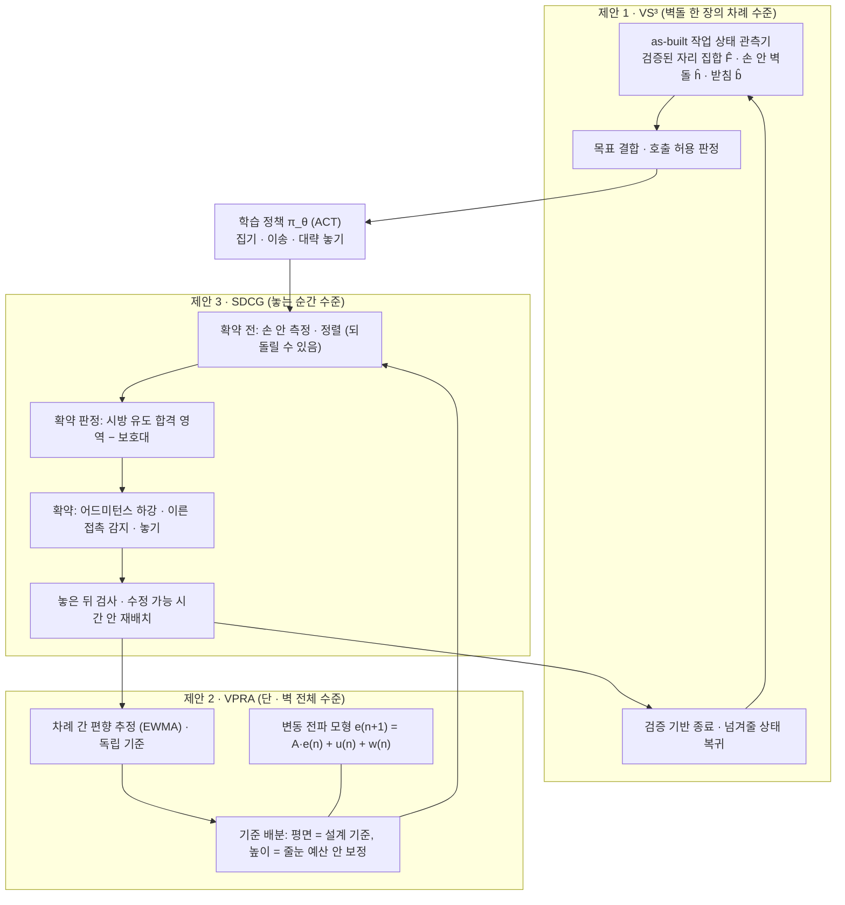

# 로봇 조적 하이브리드 제어: 기술적 기여와 방법론 제안

2026-11-02. 지도교수 피드백("응용 연구에 그치지 말고 기술적 기여와 방법론적 차별성을 보여라")에 답하기 위한 분석·제안 문서다.

- **입력 문서**: [하이브리드 결합 패턴](하이브리드_학습정책_규칙제어_결합패턴_20261102.md)(2bc5fb5), [평가지표](../01_사기설/평가지표_3층벽체_20261013.md)(fc73675 최신본), [선행연구 정밀도 조사](선행연구_목표정밀도_조사.md), [실패원인 추적](../01_사기설/근거_우분투_wall3_재학습_v2/실패원인_추적_20261028.md), [원인추적 검증](../01_사기설/근거_우분투_wall3_재학습_v2/원인추적_검증_20261029.md).
- **성격**: 아이디어 제안이다. 제안의 효과는 **아직 하나도 재지 않았다.** "향상된다"는 문장은 모두 검증할 가설이며, 각 제안에 반증 조건을 붙였다.
- **우리 자료의 수치**는 시뮬레이션 진단 자료다. 대부분 ACT v2 + G1·G2·G3, `main_v1_eval`, 100벽(700300~700399) 기록에서 왔고 출처를 표마다 적었다. 참값은 분류·채점에만 썼다.
- **문헌 표기**: [확인] = 해당 문서나 오늘 원문·초록으로 서지와 주장을 확인함. [서지] = 서지만 확인. [미확인] = 게재처나 세부를 확인하지 못함. 표기는 참고문헌 절에 모았다.

---

## 0. 요약

| | 내용 |
|---|---|
| 지금 위치 | G1·G2·G3는 결합 패턴 문서 4절대로 **P4(스위칭) + P3(안전 필터) + 규칙 회복**이다. 기존 패턴을 조적에 적용한 것이라 교수님 지적대로 응용 연구 수준이다 |
| 문헌의 공백 | 기존 결합 규칙은 행동·모드·매개변수 수준에서 학습과 규칙을 잇는다. **목표 입력과 종료 시점**(정책에게 무엇을 시키고 언제 끝내나), **제품 수준**(앞 작업의 오차가 뒤 작업을 어떻게 묶나), **외부 시방 기준**(합격 판정을 시방 허용오차와 측정 불확도에서 유도)은 다루지 않는다 |
| 근거 데이터 | 실패는 동작이 부정확해서보다 **감독과 정책의 단계가 어긋나서** 더 많이 생겼다. G1이 '쥠'으로 판정한 650회 중 411회가 차례 벽돌이 아닌 벽돌이었다. 처음 실패 87건 중 52건이 이 어긋남과 엮였다. 목표가 맞는 넘기기 시험에서는 정책이 잘 놓았다 |
| 제안 | ① 검증 상태 동기화 감독(VS³) ② 변동 전파 인지 기준 배분(VPRA) ③ 시방 유도 확약 게이트(SDCG). 세 제안은 서로 다른 시간 규모(벽돌 한 장의 차례, 단·벽 전체, 놓는 순간)를 맡아 하나의 구조로 묶인다 |
| 평가 문서와의 결합 | ① 완성률·첫 실패 위치 ② 계통·우연 분해, 단 사이 상관 ρ, 긴 벽 외삽 ③ 민감도 분석, 정규화 오차, 판정 오류율 |

---

## 1. 기존 연구의 결합 규칙: 유형과 암묵적 가정

### 1.1 결합 지점별 분류

결합 패턴 문서의 P1~P7을 "학습과 규칙이 어디서 만나는가(결합 지점)"로 다시 묶었다. 오늘 확인한 문헌(옵션 이론, 기술 잇기, 분포 복귀)을 더했다.

| 결합 지점 | 핵심 규칙 (수식·구조) | 권한 배분 | 대표 사례 | 보장하는 것 |
|---|---|---|---|---|
| **행동 공간 정의** (P1) | $a_k=\pi_\theta(o_k)$를 느린 주기로, $u=C(a_k,x)$를 빠른 주기로 | 정책 = 목표값, 제어기 = 추종·순응 | Hwangbo 2019, VICES 2019 | 안정화·순응 (하위 제어기 대역폭 안에서) |
| **행동 합산** (P2 잔차) | $a=a_{\text{base}}+\alpha\pi_\theta$, $\lVert\pi_\theta\rVert\le\delta$ | 기준 제어기 = 대부분, 학습 = 국소 보정 | Johannink 2019, TossingBot 2020, ResiP 2025 | 기준 근처 유지 (잔차 폭으로) |
| **행동 투영** (P3 안전 필터) | $a_{\text{safe}}=\arg\min_{a\in\mathcal A_{\text{safe}}(x)}\lVert a-a_\theta\rVert$ | 정책 = 제안, 필터 = 최소 수정 | CBF-QP(Cheng 2019), 예측 안전 필터(Wabersich 2021) | 상태 제약 만족 (모델이 맞다는 전제) |
| **모드 선택** (P4) | 감시자 $\sigma(x)$가 학습·규칙 중 하나를 고름 | 감시자 = 전환, 각 모드 = 실행 | Simplex, GUAPO 2020, Sentinel 2024, FAIL-Detect 2025, Rewind-IL 2026, ThriftyDAgger | 검증된 안전망 (전환 기준이 맞다는 전제) |
| **기본 동작 선택** (P5) | $a=(k,\theta_k)$, 스크립트가 실행 | 정책 = 종류·매개변수, 규칙 = 실행 | VPG 2018, Transporter 2020, MAPLE 2022 | 기본 동작의 사전 검증 |
| **제어기 내부 요소** (P6) | $\dot x=f_{\text{nom}}+\hat f_\theta$를 MPC·비선형 제어에 넣음 | 제어 법칙 = 고정, 학습 = 모델·이득 | MPPI 2017, Neural Lander 2019 | 안정성 해석 틀 유지 |
| **학습 시점** (P7 교사–학생) | 특권 교사의 행동을 관측만 쓰는 학생이 모방 | 교사 = 라벨, 학생 = 실행 | GPS 2016, Learning by Cheating 2019 | 없음 (실행 때 보장은 P3·P4 몫) |
| **기술의 시작·종료 조건** | 옵션 $\langle I,\pi,\beta\rangle$: $s_t\in I$일 때만 사용, $\beta$로 종료(Sutton 1999). 앞 기술의 종료 상태를 다음 기술의 시작 집합에 맞추도록 학습(T-STAR, Lee 2021) | 학습된 기술끼리 잇기 | Sutton 1999, Lee 2021 | 기술 사이의 연결 (학습 시 규제) |
| **분포 복귀** | 분포 밖으로 밀리면 학습 분포 쪽으로 되돌리는 회복 정책(Reichlin 2022). 되감기(Rewind-IL) | 회복 = 학습 또는 규칙 | Reichlin 2022, Rewind-IL 2026 | 사후 복귀 |

### 1.2 기존 규칙들의 공통 암묵적 가정과 조적에서 깨지는 곳

| # | 암묵적 가정 | 주로 기대는 패턴 | 조적에서 | 우리 자료 |
|---|---|---|---|---|
| A1 | **감독은 지금 작업 단계를 안다.** 단계는 시간·순서 카운터로 충분하다 | P4, 상태기계 | 감독의 차례 번호와 정책이 실제로 다루는 벽돌이 어긋난다 | G1 '쥠' 650회 중 411회가 차례 벽돌이 아님. 2번째 차례에 G2가 돈 87벽 중 85벽에서 정책이 이어서 다른 벽돌을 쥠(10-26 평가 기록, 11-02 재집계) |
| A2 | **규칙이 끝난 뒤 넘겨받은 상태도 정책이 다룰 수 있다** | P3, P4 | 학습 시연은 벽돌마다 '철수 자세 → 집기 → 놓기 → 철수'로 끝난다. 검측 뒤 넘겨주는 자세(벽에서 38 cm 물러나 25 cm 위, 집게 열림)가 시연에 있는지는 확인하지 않았다 | 결합 패턴 문서도 P4 단점으로 "학습 정책은 다른 모드가 남긴 상태를 본 적이 없을 수 있다"를 적었다 |
| A3 | **안전·품질 제약은 현재 상태만의 함수다**(마르코프, 국소) | P3 (CBF, 예측 필터) | 시방 항목 ②③④는 벽 전체 벽돌의 최소제곱 면·단 사이 수직선으로 정의된다. 벽돌 한 장의 '좋음'이 이미 놓인 벽돌들에 달려 있다 | 평가지표 2.3절 측정 정의 |
| A4 | **에피소드는 독립이고, 성공은 이진이다** | 거의 전부 | 앞 벽돌의 오차가 물리적으로 다음 단의 받침이 된다. 판정은 mm 연속값과 허용오차다 | 처음 실패 뒤 88/100벽은 한 장도 더 못 채움(10-26 평가) |
| A5 | **행동은 되돌릴 수 있고, 작은 오차는 작은 결과를 낳는다** | P2, RL 전반 | 놓은 뒤 모르타르가 굳으면 되돌릴 수 없다. 세로줄눈 틈이 10 mm뿐이라 옆으로 7~23 mm 치우치면 이웃 벽돌 끝에 걸쳐 기운다(불연속) | 걸침 처음 실패 18건(10-28 추적) |
| A6 | **검사 기준은 설계자가 정한 문턱이다** | P4 감시, 실패 감지 | 합격 기준이 외부 시방서(KCS)에 있고, 검측 카메라 자체에 불확도가 있다 | G3 문턱 3 mm는 '임시'이며 시방에서 유도해 동결할 예정(평가지표 7절) |

### 1.3 정리: 공백 세 가지

| 공백 | 내용 | 가장 가까운 선행 | 차이 |
|---|---|---|---|
| **공백 A** 목표·종료 결합 | 학습 정책에게 줄 **목표 입력**과 **에피소드 종료**를 센서로 검증한 작업 상태에서 정하는 규칙 | 옵션 이론(Sutton 1999), T-STAR(Lee 2021), Sentinel·FAIL-Detect·Rewind-IL | T-STAR는 학습된 기술끼리 학습 시점에 잇는다. 실패 감지 계열은 실패한 뒤 반응한다. **학습 정책과 규칙 제어기를 실행 시점에, 재학습 없이, 실패 전에** 맞추는 규칙은 찾지 못했다 |
| **공백 B** 제품 수준 결합 | 앞 작업의 오차가 뒤 작업으로 전파되는 것을 모형화하고, 규칙 층이 그 전파를 제어하는 구조 | 변동 전파(stream of variation) 상태공간 모형(Jin & Shi 1999, Shi 2006), 절대 기준 재등록(Giftthaler 2017) | 변동 전파는 제조 공정 모형이며 학습 정책과 결합한 사례를 찾지 못했다. Giftthaler는 학습 없이 절대 기준으로만 누적을 막았고, 높이 방향의 물리적 결합(받침)은 다루지 않았다 |
| **공백 C** 시방 기준 결합 | 검사 게이트의 합격 영역을 시방 허용오차와 측정 불확도에서 **유도**하는 규칙 | 적합성 판정 규칙·보호대(ISO 14253-1, JCGM 106), 오차 예산 | 측정학의 판정 규칙을 로봇 하이브리드 제어의 '놓기 확약' 판단에 쓴 사례를 찾지 못했다 |

> 검색 범위: 결합 패턴 문서 47편, 선행연구 정밀도 조사(2026-09-08), 오늘 표적 검색 12건. 체계적 문헌 고찰이 아니므로 논문에서는 "확인한 범위에서"로 쓴다.

---

## 2. 로봇 조적의 고유한 물리·공정 특성

일반 집기·놓기와 구별되는 특성만 적었다. 값의 출처는 오른쪽 열에 있다.

| # | 특성 | 정량 | 출처 | 제어·학습에 주는 함의 |
|---|---|---|---|---|
| D1 | **판정이 제품(벽) 수준의 기하 시방이다** | ① 가로줄눈 10 ± 3 mm(1단 아래 0~3 mm) ②③④ 6 mm(문언 적용) ⑤ −6~+13 mm | KCS 41 34 00 허용오차(평가지표 2.1절 채택값, 조항 번호 원문 확인 전) | 벽돌별 목표 오차를 최소화하는 것과 시방 항목을 최소화하는 것이 같지 않다. 비용이 벽돌들 사이에 결합된다(A3) |
| D2 | **허용오차 < 정책의 시각 해상도** | 정책 카메라 128²에서 벽 근처 한 화소 약 9.6 mm(앞), 11 mm(top). 손목 1.3~2.6 mm. 검측용 top 1280×960은 약 1.5 mm. 영상 IL의 정밀도 하한은 시뮬레이션에서도 약 2.35~2.75 mm | 11-01 분석(문서화 안 됨). Curse of Precision(ICRA 2026) [선행 조사에서 본문 확인] | 감각운동 정책 혼자서는 허용오차 규모를 분해할 수 없다. 정밀도는 별도 계측 경로(고해상도·깊이)에서 와야 한다 → **권한 배분의 물리적 근거** |
| D3 | **틈에서 생기는 결과의 분기**(접촉 모드 불연속) | 벽돌 190 mm, 자리 간격 200 mm → 세로줄눈 틈 10 mm. 7~23 mm 치우치면 이웃 끝에 걸쳐 +29 mm, 약 19° 기울어짐 | 설계(config), 10-28 추적 ② | 최종 자세 분포가 둘로 갈렸다. 진단 100벽의 자리 45 mm 안 벽돌은 ±2 mm·1° 미만 무리와 +20 mm·15° 이상 걸침 무리로 나뉘었고, 그 사이는 없었다(11-01 진단 집계, 문서화 안 됨). 작은 연속 보정(잔차)으로 배울 수 없는 실패다 |
| D4 | **높이 방향은 물리적으로 앞 단에 묶이고, 줄눈 두께가 유일한 보정 수단이다** | 벽돌은 실제 아래 단 위에 놓인다(설계 높이에 독립적으로 놓을 수 없다). 가로줄눈 허용폭 ±3 mm가 높이 보정 예산이다 | 기하, 평가지표 ① | 높이 오차는 구조상 누적되기 쉽다(2.6절 '앞 단 기준형'). 현재 시뮬레이션 모르타르는 두께 고정 탄성층이라 **눌러서 두께를 바꾸는 보정이 재현되지 않는다**(평가지표 각주 mortar) |
| D5 | **재료가 시간에 따라 변하고, 확약 뒤에는 되돌릴 수 없다** | 학습 환경 `main_v1`은 손이 떠나고 2 s 정지하면 굳는다. 평가 환경 `main_v1_eval`은 경화 2 h(벽 하나 쌓는 동안 안 굳음, 사용자 결정 10-22) | config.py | 수정 가능 시간 안에서만 다시 놓을 수 있다. 2 s 환경에서 G3는 부분 시야로라도 빨리 판정해야 했다(`g3_partial_margin`). 놓기는 되돌릴 수 없는 확약이다(A5) |
| D6 | **선후 관계와 모양 이질성** | 단 순서, 아래 단이 끝나야 판이 깔림, 2단 양 끝은 반장(90 mm). 공급 칸마다 정해진 벽돌 | 설계, scene.py | 이산 작업 상태(어느 자리가 검증됐나, 손에 무슨 모양이 있나)를 추적해야 한다. 차례 번호로 대신하면 모양이 틀린다: 6번째 차례 G2 49회 중 32회가 손 안 벽돌을 못 찾았다(G2는 차례 자리의 길이로 찾음, [gates.py](../sim/wall3/gates.py) 188행) |
| D7 | **긴 순차 작업에서 첫 실패가 나머지를 무너뜨린다** | 16장. 처음 실패 뒤 88/100벽은 한 장도 더 못 채움. 처음 실패 뒤 제 벽돌이 공급대에 있어도 손이 그 5 cm 안까지 간 차례는 1%(12/906) | 10-26 평가, 10-29 검증 | 제품이 오차를 물리적으로 들고 간다. 탁상 과제처럼 매번 초기화되지 않는다 |
| D8 | **무겁고 단단한 물체를 마찰로 쥔다** | 온장 약 1.95 kg(2000 kg/m³ × 190×90×57 mm), 반장 약 0.92 kg. 이송 중 최대 가속 7.4 m/s² | 계산, config `lock_amax` | 손 안 자세가 이송 중 변할 수 있다. 놓기 직전에 다시 재야 한다(G2의 역할) |
| D9 | **놓기와 검사가 같은 센서를 쓴다**(측정 독립성 부족) | G2·G3 모두 같은 top 카메라. 현재 깊이 잡음 없음(G3 측정 오차 중앙 0.2 mm, 95% 0.8 mm) | gates.py, 원인 분석 | 카메라의 공통 편향(보정 오차)은 G3가 볼 수 없다. 현장 시스템은 독립 기준(레이저 줄, 기준 막대, 레이저 트래커)을 둔다(선행 조사 A1·A2) |

벽돌 치수 편차(KS L 4201 허용차)는 원문 값을 확인하지 못해 표에 넣지 않았다. 현재 시뮬레이션에도 없다(로드맵 E11).

---

## 3. 제안: 시방에 근거한 하이브리드 모방 제어

### 3.0 전체 구조

세 제안은 서로 다른 시간 규모를 맡는다.

| 층 | 시간 규모 | 학습이 맡는 것 | 규칙이 맡는 것 |
|---|---|---|---|
| VS³ | 벽돌 한 장(약 17 s) | 집기 · 이송 · 대략 놓기(시연 분포 안에서) | 무엇을 시킬지(목표), 언제 끝낼지(종료), 어디서 넘겨받을지(시작 상태) |
| SDCG | 놓는 순간(수 초) | 없음 | 확약할지 판정, 접촉 구간 순응 제어 |
| VPRA | 단 · 벽(분~시간) | 없음 | 기준 배분, 차례 간 편향 보정 |

### 3.1 제안 1: 검증 상태 동기화 감독 (Verified-State Synchronized Supervision, VS³)

**핵심 개념.** 학습된 감각운동 정책을 옵션 $\omega=\langle I_\omega,\pi_\theta,\beta_\omega\rangle$으로 본다(Sutton 1999: 옵션은 $s_t\in I$일 때만 쓸 수 있다). 지금은 이 셋이 암묵적이다.

- 시작 조건 $I$: 따지지 않는다.
- 종료 $\beta$: 시간(17 s) 또는 정책 스스로의 철수로 정한다.
- 목표: 차례 카운터가 정한다.

VS³는 이 셋을 **센서로 검증한 as-built 작업 상태** 하나에서 만든다.

작업 상태 관측기 $\hat s=(\hat F,\hat h,\hat b)$의 구성은 다음과 같다.

| 기호 | 뜻 | 쓰는 센서 |
|---|---|---|
| $\hat F$ | top 카메라 검사(G3)로 확정한 자리 집합 | top 카메라 |
| $\hat h$ | 손 안 벽돌의 정체와 모양. G1 '쥠' 순간 손 위치를 공급 칸 배치표에 맞춰 구함 | 관절값(순기구학) + 도면 |
| $\hat b$ | 받침(모르타르 판)이 준비됐는지 | top 카메라 |

| 규칙 | 내용 | 지금 코드 |
|---|---|---|
| R1 목표 결합 | 목표 $g=\text{design}(j^{\ast})$, $j^{\ast}=\min\lbrace j\notin\hat F:\ \text{공급 칸 }j\text{에서 아직 안 집음},\ \text{아래 단 }\subseteq\hat F\rbrace$ | 차례 카운터 $k$ |
| R2 호출 허용 | $(\hat s,g)$가 시연을 만든 조건(앞 자리 모두 확정, 목표 벽돌이 공급대에 있음, 팔이 철수 자세)과 같을 때만 정책을 부름. 아니면 규칙 회복 또는 멈춤 | 확인 안 함 |
| R3 검증 종료 | 규칙 층이 놓기와 검사를 끝내면 옵션을 끝냄. 팔을 철수 자세(시연의 시작·끝 상태)로 보내고 정책의 행동 청크와 이력을 비움 | 검사 뒤 정책에 돌려줌 → 정책이 다음 벽돌을 이어서 집음 |
| R4 기준 일치 | G2·G3의 기준 자리와 모양 = $\hat h$에서 정함. 모양이 다르면 차례 자리로 끌고 가지 않음 | 차례 자리 $k$ 기준 |
| R5 실패 시 멈춤 | 재시도 한도를 넘어도 확정 못 하면 그 벽을 멈추고 이유를 기록 | 시간이 지나면 다음 차례 |

**기존 방법보다 나아지는 근거 (가설과 근거 자료).**

1. **정책은 시연 분포 안에서만 믿을 수 있다.** 행동 복제는 분포 밖 상태에서 오차가 쌓인다(Ross 2011; 결합 패턴 문서 P7 단점). R2·R3은 정책을 부르는 상태를 시연과 같은 조건으로 제한한다. 즉 정책을 고치지 않고 **입력 쪽에서 분포 이탈을 막는다.**
2. **우리 시스템의 주된 실패가 바로 이것이다.** 처음 실패 87건 중 52건이 차례와 벽돌의 어긋남과 엮였다(① 22, ② 17, ③ 13; 10-28 추적). 2번째 차례에 G2가 돈 87벽 중 85벽에서, 검측이 놓기를 끝낸 뒤 정책이 이어서 다른 벽돌을 쥐었다(10-26 평가 기록). R3은 이 구간을 구조적으로 없앤다.
3. **목표가 맞으면 정책은 잘 했다.** 목표 입력이 맞는 넘기기 시험에서 6번째 반장은 중앙값 2.6~5.2 mm로 놓였고 넘어진 적이 없다(10-28 추적 ③). 따라서 동기화가 맞으면 남는 오차는 정책의 운동 정밀도 쪽이고, 그것은 제안 3이 맡는다.
4. **단순 PID·CBF와의 차이.** 이 실패는 연속 상태 제약 위반이 아니라 이산 작업 상태의 불일치다. 행동을 투영하는 필터(P3)나 추종 제어기(P1)의 적용 범위 밖이다.

**선행과의 차이.**

| 선행 | 하는 일 | VS³ |
|---|---|---|
| T-STAR (Lee 2021) | 학습된 기술끼리 종료 상태를 학습 시점에 규제 | 학습 정책 ↔ 규칙 제어기, 실행 시점, 재학습 없음 |
| Sentinel · FAIL-Detect · Rewind-IL | 실패 징후를 감지한 뒤 멈추거나 되감음 | 실패 전에 목표와 종료를 맞춤(예방). 판단 근거가 학습 점수가 아니라 측정한 작업 상태 |
| Reichlin 2022 | 분포 밖으로 밀리면 학습 분포로 되돌리는 회복 정책을 학습 | 규칙 층이 시연의 시작 상태(철수 자세)로 되돌림. 학습 불필요 |
| GUAPO 2020 | 인식 불확실성으로 모델·학습 영역을 전환 | 전환 기준이 작업 진행 상태(검증된 자리 집합) |

**평가 문서와의 결합.**

| 평가 항목 (평가지표) | 쓰는 법 |
|---|---|
| 주 지표 1 완성률(2.5절) | 같은 시작값 짝 비교, 배치 단위 부트스트랩 95% 신뢰구간 |
| 주 지표 2 항목별 연속 오차 | 두 조건 모두 완성된 배치만 짝지음. 빠진 배치 수를 함께 적음 |
| 기전 지표(진단, 참값은 분류에만) | 어긋남률(쥔 벽돌 ≠ 목표 벽돌), 시연 조건 밖 호출 비율, 첫 실패 위치 분포, 멈춤 수와 이유 |
| 요인 분리 | R3만 → R3 + R4 → 전체. 한 번에 하나씩 넣음(로드맵 사다리 원칙) |

- **반증 조건**: R3을 넣어도 2번째 차례 이후 어긋남률이 줄지 않거나, 줄어도 완성률 신뢰구간이 기준선과 겹치면 가설 2를 기각한다.
- **한계**: R5(멈춤)는 채움 수를 늘리지 않는다. 처음 실패 뒤 더 채운 벽은 12/100이라 비용은 작다. 다만 성능 비교는 R1~R4로 하고 R5는 따로 보고한다.

### 3.2 제안 2: 변동 전파 인지 기준 배분 (Variation-Propagation-Aware Reference Allocation, VPRA)

**핵심 개념.** 벽을 단 $n$을 공정 단계로 하는 **다단 공정**으로 본다. 제조의 변동 전파(stream of variation) 상태공간 모형(Jin & Shi 1999; Shi 2006)과 같은 꼴로 단 사이 오차를 쓴다. 같은 $x$ 위치에서 단 $n$ 벽돌의 오차를 $e_n=(e_y,e_z,e_\theta)$라 하자.

$$e_{n+1}=A\,e_n+u_n+w_n,\qquad w_n\sim(\mu_w,\ \sigma_w^2),\qquad |u_n|\le\bar u$$

| 기호 | 뜻 |
|---|---|
| $A$ | 단 사이 결합. 앞 단을 기준으로 놓으면 1, 설계(절대) 기준으로 놓으면 0 |
| $u_n$ | 규칙 층의 보정 |
| $\bar u$ | 시방에서 오는 보정 예산 |
| $w_n$ | 놓기 오차(정책 + 검측). 평균 $\mu_w$가 계통 성분, $\sigma_w$가 우연 성분 |

**축마다 다른 기준을 배분한다.**

| 축 | 물리적 제약 | 배분 | 보정 예산 |
|---|---|---|---|
| 평면($y$, $x$, $\theta$) | 받침과 무관하게 설계 좌표로 잴 수 있다 | **설계 기준**($A\approx 0$). Giftthaler 2017은 모든 스캔을 같은 초기 기준에 등록해 누적이 없었다 | ④ 6 mm 안에서 |
| 높이($z$) | 실제 아래 단 위에 놓인다($A=1$, D4) | **보정 되먹임** $u_{z,n}=-\mathrm{sat}(\kappa\,e_{z,n},\ 3\ \text{mm})$: 줄눈 두께로 설계 높이 쪽으로 되돌림 | ① ±3 mm |

**이론적 근거 (단순 모형에서 우리가 유도한 것).** 포화 없이 $\varphi=1-\kappa$로 쓰면 $e_{n+1}=\varphi e_n+w_n$이다.

| 경우 | 평균 | 분산 | 3 m 높이(약 45단)에서 예상 최대 이격 |
|---|---|---|---|
| $\varphi=1$ (보정 없음, 앞 단 기준) | $n\mu_w$ (선형 증가) | $n\sigma_w^2$ | $\lvert\beta\rvert\cdot 45+2\sigma\sqrt{45}$ (평가지표 2.6절 '앞 단 기준형'과 같음) |
| $0\le\varphi<1$ (보정) | $\mu_w/(1-\varphi)$로 수렴 | $\sigma_w^2/(1-\varphi^2)$로 수렴 | $\lvert\mu_w\rvert/(1-\varphi)+2\sigma_w/\sqrt{1-\varphi^2}$ (단 수와 무관, 유계) |

- **평가 지표가 곧 모형 식별이다.** 평가지표의 단 사이 잔차 상관 $\rho$는 이 모형에서 $\varphi$의 추정값이다. 단당 기울기 $\beta$는 $\varphi=1$일 때 $\mu_w$의 추정값이다. 평가 문서가 이미 정한 계산으로 제어 구조의 실효 이득을 데이터에서 읽을 수 있다.
- **차례 간 편향 보정**(run-to-run, 반도체 공정의 EWMA 제어기; Ingolfsson & Sachs 1993 [서지]). G3가 잰 놓은 뒤 잔차 $m_n$으로 $\hat\mu_{n}=\lambda m_n+(1-\lambda)\hat\mu_{n-1}$를 갱신하고, 다음 G2 목표에서 뺀다. 측정 잡음 $\nu$만 있는 단순 모형에서 추정 오차는 $d_n=(1-\lambda)d_{n-1}+\lambda\nu_n$이다. 따라서 $0<\lambda<2$이면 안정이다(우리 유도. 원 논문의 안정 조건은 이번에 확인하지 않음).
- **관측 가능성 조건.** G2와 G3가 같은 카메라를 쓰면 카메라 공통 편향 $b_c$가 G2의 배치와 G3의 측정에서 서로 지워진다(G3 잔차 ≈ 0). 그래서 $\hat\mu$는 $b_c$를 볼 수 없다. **독립 기준**이 필요하다: 같은 영상 안의 기준 표식이나 바닥 먹선에 대한 상대 측정, 또는 다른 시점 카메라. 현장의 기준 막대·레이저 줄과 같은 역할이다(D9).

**기존 방법보다 나아지는 근거.**

- 정책 단독(IL)이나 벽돌별 PID·CBF는 벽돌마다 고정 목표와의 오차를 줄인다. **어떤 기준으로 놓을지**(절대인가 상대인가)와 **보정 예산을 단 사이에 어떻게 나눌지**는 정하지 않는다.
- 물리적으로 결합된 높이 방향에서는 벽돌별 최적이 벽 최적이 아니다. 모형은 $\varphi<1$이면 오차가 유계, $\varphi=1$이면 $\sqrt n$·$n$으로 커진다고 예측한다. 시방 기준 길이(3 m, 9 m)로 외삽할 때 차이가 커진다.

**선행과의 차이.**

- 변동 전파 모형은 판금·기계 조립의 공정 설계 도구다. 학습 정책을 공정 잡음원으로 넣고 규칙 층이 전파를 제어하는 구조, 그리고 조적 단 사이 결합에 적용한 사례는 오늘 검색에서 찾지 못했다.
- Giftthaler 2017은 학습 없이 절대 기준만 썼고, 높이의 받침 결합과 줄눈 예산은 다루지 않았다.

**평가 문서와의 결합 (2.6절을 그대로 씀).**

| 평가 항목 | 쓰는 법 |
|---|---|
| 계통 오차 μ, 추세 $b$(mm/m), $\beta$(mm/단) | 조건별 비교. 가설: VPRA에서 $\lvert\beta\rvert$ 감소 |
| 우연 오차 σ | 조건별 비교 |
| 단 사이 상관 ρ | 가설 H2a: 평면 축에서 설계 기준 G2는 $\rho\approx0$, 정책 단독은 $\rho>0$. 가설 H2b: 높이 축에서 줄눈 보정이 있으면 $\rho$가 1보다 작아짐 |
| 외삽 $D$ (3 m · 45단 · 9 m) | 두 가지 형태로 계산해 6 mm와 비교. "긴 벽에서 맞는다"가 아니라 "가정과 성장 법칙"으로 보고(평가지표 2.6절 한계) |
| 정규화(mm/m, °) | 시방 비율 2 mm/m(약 0.11°)과 비교 |
| 공통 편향 시험 | 카메라 보정 오차(로드맵 E10)를 일부러 넣고, 독립 기준 유무에 따라 μ가 보이는지 확인 |

- **반증 조건**: H2a에서 정책 단독의 평면 ρ가 이미 0 근처면 기준 배분의 평면 효과는 없다(그 경우 높이 축만 남음).
- **한계와 결정 필요**:
  - 3단 · 단당 5장이라 ρ와 추세의 추정이 약하다(평가지표 2.6절). 본 실험과 별도로 대본 + 검측만으로 높은 벽을 쌓는 진단 실험이 필요할 수 있다.
  - **높이 보정(H2b)은 현재 모르타르 모델로 재현되지 않는다**(D4). 모르타르 모델 변경은 2026-10-13 팀 결정(모델 유지)을 바꾸는 일이라 팀 결정이 필요하다. 평면 축(H2a)과 편향 보정은 지금 모델로 시험할 수 있다.

### 3.3 제안 3: 시방 유도 확약 게이트 (Specification-Derived Commitment Gating, SDCG)

**핵심 개념.** 놓기를 두 구간으로 나눈다.

- **확약 전**(손 안 측정, 정렬): 되돌릴 수 있다.
- **확약**(접촉, 누르기, 놓기): 모르타르가 굳으면 되돌릴 수 없다(D5).

확약할지는 **시방에서 유도한 합격 영역**과 **측정 불확도**로 정하는 통계적 적합성 판정이다. 확약 구간은 순응 제어로 실행한다.

**(a) 시방 → 벽돌별 합격 영역.** 벽 시방 항목 벡터 $S(P)$(①~⑤)를 벽돌 $i$의 자세 변화에 대해 1차 근사한다.

$$\delta S\approx J_i\,\delta p_i,\qquad \mathcal A_i=\lbrace\delta p_i:\ |(J_i\,\delta p_i)_k|\le T_k^{(i)}-k_c\,u_c\ \ \forall k\rbrace$$

| 기호 | 뜻 | 출처 |
|---|---|---|
| $J_i$ | 벽돌 하나의 어긋남이 각 항목을 얼마나 움직이는가 | 평가지표 2.8절에 이미 1차 근사가 있음: 수평 회전 $95\sin\theta$, 길이 방향 기울기 $95\sin\varphi$, 앞뒤 기울기 $57\sin\psi$ |
| $T_k^{(i)}$ | 항목 $k$의 허용오차 중 벽돌 $i$에 배분한 몫 | 최악 합산 또는 제곱합 배분(로드맵의 오차 예산과 같은 방식) |
| $u_c$ | 검측의 합성 표준 불확도 | GUM(JCGM 100) 방식 |
| $k_c$ | 포함 계수. $k_cu_c$가 보호대(guard band) | 적합성 판정 규칙(ISO 14253-1, JCGM 106)의 보호대 개념 |

정규 분포 모형에서 $k_c=2$이면 한쪽 거짓 합격 확률이 약 2.3% 이하다. 이 값은 우리 계산이며, 표준이 정한 기본값은 원문으로 확인해야 한다.

**(b) 확약 판정.** 아래 표처럼 판정하고, 판정 단계마다 시간·횟수 한도를 둔다.

| 조건 | 행동 |
|---|---|
| $P(\delta p_i\in\mathcal A_i\mid\text{측정})\ge 1-\alpha$ | 확약 |
| 불확도 때문에 판정 못 함 | 다른 시점에서 다시 재서 $u_c$를 줄임 (G2의 다시점 측정을 일반화) |
| 영역 밖 | 다시 정렬 |
| 한도 초과 | 물러남 |

**(c) 확약 구간의 순응 제어와 이른 접촉 감지.** 내릴 때 말단 어드미턴스 제어를 쓴다.

$$M\ddot x+D\dot x+K(x-x_d)=F_{\text{ext}}$$

손목 힘 센서로 닿는 높이 $z_{\text{contact}}$를 잰다. 기대 높이는 $z_c=\hat z_{\text{support}}$(카메라로 잰 받침)다.

- 걸침이 될 자세에서는 벽돌 끝이 같은 단 이웃의 윗면에 먼저 닿는다. 그 높이는 받침보다 약 $H=57$ mm 높다(기하).
- 그래서 문턱 $\delta$를 모르타르·측정 편차(mm 단위)보다 크고 57 mm보다 훨씬 작게 잡을 수 있다. $z_{\text{contact}}-z_c>\delta$이면 **놓기 전에** 들어 올려 다시 정렬한다.
- 이렇게 하면 D3의 불연속 실패(걸침)를 되돌릴 수 없는 결과에서 확약 전에 잡히는 사건으로 바꾼다.
- 20 Hz에서도 내리는 속도 20 mm/s면 한 주기에 1 mm라 감지 지연이 작다. 500 Hz 경로(로드맵 E8)는 선택 사항이다.

**(d) 놓은 뒤 검사.** 같은 $\mathcal A_i$와 보호대로 판정한다. 재배치는 모르타르 수정 가능 시간 안에서만 한다.

**기존 방법보다 나아지는 근거.**

| 비교 대상 | 왜 부족한가 | SDCG |
|---|---|---|
| CBF·안전 필터(P3) | 안전 집합을 상태에 대해 미리 정하고 매 주기 지킨다. 여기 품질 제약은 벽 수준이고(A3), 불확도를 가진 측정으로만 알 수 있으며, 위반이 확약 순간 되돌릴 수 없게 된다(A5). 맞는 추상화는 연속 투영이 아니라 **확약 시점의 통계적 판정**이다 | 확약 시점 판정 |
| PID·임피던스 단독 | 힘·위치를 조절하지만 '합격인가'라는 개념이 없다 | 시방 합격 영역과 결합 |
| 학습 단독 | 허용오차 규모를 분해하지 못한다(D2) | 고해상도 계측 경로가 판정 |
| 지금 G3 (임시 3 mm) | 문턱의 근거가 없다(평가지표 7절) | 문턱이 시방과 불확도에서 유도되고, 거짓 합격률을 불확도 모형 안에서 묶을 수 있다 |

**선행과의 차이.**

- 측정학의 적합성 판정 규칙과 오차 예산은 제조 검사에서 쓰인다. 이를 학습 정책 위의 '놓기 확약' 판단과 순응 접촉 실행에 결합한 사례는 오늘 검색에서 찾지 못했다.
- 모르타르 동역학을 고려한 조적 힘-위치 제어(Zhou 2025 [서지])는 접촉 제어 쪽 선행이다. 합격 판정 유도와 학습 정책 결합은 다루지 않는 것으로 보이나 초록을 확인하지 못했다.

**평가 문서와의 결합.**

| 평가 항목 | 쓰는 법 |
|---|---|
| 민감도 분석(2.7절) | 허용오차 곡선 $T$ = 1~6 mm. SDCG는 게이트 자체가 $T$에서 유도되므로, 평가지표 각주대로 $T$를 바꾸면 G3 조건을 다시 돌려야 한다. 그래서 $T$ 2~3개 수준에서 게이트를 다시 설계하고 다시 돌려, **설계 기준과 채점 기준이 같이 움직일 때** 합격률과 연속 오차가 어떻게 변하는지 본다(채점만 바꾸는 기존 민감도 분석보다 강한 시험) |
| 정규화 오차(2.5절) | ②는 mm/m, ③은 기울기 각(°)으로 보고. 2.8절의 걸리기 시작하는 각(회전 3.6°, 기울기 1.8°)과 함께 |
| 게이트 판정 오류율(새 진단, 참값은 채점만) | 벽돌별 (합격·불합격 판정) × (참 적합·부적합) 2×2 표 → 거짓 합격률·거짓 불합격률. $k_c$를 바꾼 곡선 |
| 걸침률 | 최종 자세가 걸침 무리(+20 mm 이상, 15° 이상)에 든 벽돌 비율. 걸쳤는데 '채움'으로 센 21곳(10-29 검증) 같은 사례가 사라지는지 |
| 벽돌 → 벽 일관성 | 벽돌별 합격 영역을 모두 통과한 벽이 실제로 ①~⑤를 통과하는가(배분 $T_k^{(i)}$의 검증) |

- **반증 조건**: 이른 접촉 감지를 넣어도 걸침률이 줄지 않으면 (c)를 기각한다. 보호대를 넣어도 거짓 합격률이 그대로면 불확도 모형이 틀린 것이다.
- **한계와 결정 필요**:
  - 지금 검측 깊이 영상에는 잡음이 없어 $u_c$가 너무 작다(G3 측정 오차 중앙 0.2 mm). 보호대 시험에는 깊이 잡음과 보정 오차(로드맵 E2·E10)를 넣은 환경이 필요하다.
  - 누르기로 줄눈 두께를 바꾸는 효과는 현재 모르타르 모델에서 재현되지 않는다(D4).

### 3.4 세 제안의 검증 순서

| 순서 | 조건 | 비교 대상 | 주로 보는 지표 |
|---|---|---|---|
| 0 | 기준선: ACT + G1·G2·G3 (지금) | - | 완성률, ①~⑤, 기전 지표 |
| 1 | + VS³ (R3 → R3 + R4 → 전체) | 0 | 완성률, 어긋남률, 첫 실패 위치 |
| 2 | + VS³ + SDCG | 1 | 걸침률, 판정 오류율, ①~⑤ 연속 오차 |
| 3 | + VS³ + VPRA | 1 | μ, σ, ρ, $\beta$, 외삽 $D$ |
| 4 | + VS³ + SDCG + VPRA | 2, 3 | 상호작용 |

- 순서 1을 먼저 둔다. 동기화가 맞지 않으면 다른 두 제안의 효과가 어긋남 실패에 묻히기 때문이다.
- 개발은 롤아웃 블록(700053~700199, 700300~700399)에서만 한다. 시험 블록(730000+)은 최종 1회만 쓴다.
- 짝 비교와 부트스트랩은 평가지표 2.5절 방식을 따른다.

---

## 4. Research Contributions (논문 초안)

> 결과 수치는 실험 뒤에 넣는다. "first"·"novel" 같은 주장은 체계적 문헌 고찰 전까지 쓰지 않는다.

Our main contributions are threefold:

1. **Verified-state synchronized supervision for hybrid imitation learning.** We identify *supervisor–policy phase desynchronization* as a major failure mode when a chunked visuomotor imitation policy is embedded in a rule-based sequencer for long-horizon construction. In this failure mode, the policy's latent task phase diverges from the sequencer's turn counter, so the goal input and the rule-based corrections act on the wrong sub-task. We propose a supervision scheme that treats the learned policy as an option whose goal binding, admissible initiation states, and termination are derived from a sensor-verified as-built task state rather than from elapsed time. The scheme is designed to keep policy invocations within the support of the demonstration distribution without retraining the policy.

2. **Variation-propagation-aware reference allocation.** We cast robotic masonry as a multistage process in which placement errors propagate across courses through physical support. We derive a reference-allocation and run-to-run compensation law: plan-position references are absolute, and vertical deviations are regulated within the bed-joint tolerance budget. Under a linear propagation model, the law bounds course-to-course error accumulation and states the observability condition under which systematic bias can be compensated. The same model yields the estimators used in our evaluation (systematic–random decomposition and inter-course residual correlation), linking the control design to extrapolated compliance at code-reference lengths.

3. **Specification-derived commitment gating with compliant placement.** We introduce a procedure that converts wall-level construction tolerances (KCS 41 34 00) into per-brick acceptance regions through first-order sensitivities of the specification metrics. These regions are tightened by guard bands derived from measurement uncertainty. The procedure is combined with an admittance-controlled, verify-before-commit placement that detects contact-mode bifurcation (perching on a neighbouring unit) before the irreversible release. We evaluate it with continuous per-item specification errors, decision error rates against simulator ground truth, and a sensitivity analysis in which the gate design and the scoring tolerance are varied jointly.

---

## 5. 확인된 것과 가설

| 문장 | 상태 |
|---|---|
| G1·G2·G3는 P4 + P3 + 규칙 회복이다 | 결합 패턴 문서 4절 |
| 처음 실패 87건 중 52건이 어긋남과 엮임 | 10-28 추적(다시 돌린 100벽) |
| 650회 중 411회가 다른 벽돌, 2번째 차례 87벽 중 85벽 | 10-26 평가 기록을 11-02 재집계(참값 분류) |
| 6번째 차례 G2 49회 중 32회가 손 안 벽돌을 못 찾음 | 같은 재집계. 길이 불일치가 원인이라는 연결은 **확인 안 함** |
| 최종 자세가 둘로 갈림 | 11-01 진단 집계, 문서화 안 됨 |
| VS³ · VPRA · SDCG가 성능을 올린다 | **가설.** 하나도 재지 않음 |
| $0<\lambda<2$ 안정, $k_c=2$에서 거짓 합격 약 2.3% | 단순 모형에서 우리가 유도. 원 문헌 조건은 미확인 |
| 선행에 같은 방법이 없다 | 표적 검색 범위에서만. 체계적 고찰 필요 |

**결정이 필요한 것.**

| 항목 | 이유 |
|---|---|
| 모르타르 모델 변경 여부 | VPRA 높이 보정(H2b)과 SDCG 누르기 효과는 지금 모델로 재현되지 않는다. 2026-10-13 팀 결정(모델 유지)을 바꾸는 일이다 |
| 검측 잡음·보정 오차 환경 | SDCG 보호대와 VPRA 독립 기준 시험에 필요하다(로드맵 E2·E10). 평가 환경 버전을 새로 만든다 |
| G3 기준을 시방에서 유도해 동결 | 평가지표 7절과 같은 일. SDCG가 그 유도 방법이 된다 |

---

## 참고문헌

이 문서에서 인용한 것만 적었다.

| 출처 | 문헌 |
|---|---|
| 결합 패턴 문서 [확인] | Hwangbo 2019; Martín-Martín 2019 (VICES); Johannink 2019; Zeng 2020 (TossingBot); Ankile 2025 (ResiP); Cheng 2019; Wabersich & Zeilinger 2021; Seto 1998 (Simplex, [서지]); Lee 2020 (GUAPO); Agia 2024 (Sentinel); Xu 2025 (FAIL-Detect); Zheng 2026 (Rewind-IL, 게재처 미확인); Zeng 2018 (VPG); Zeng 2020 (Transporter); Nasiriany 2022 (MAPLE); Williams 2017 (MPPI); Shi 2019 (Neural Lander); Levine 2016 (GPS); Chen 2019 (Learning by Cheating) |
| 선행연구 정밀도 조사 [본문 확인 표기 항목] | Giftthaler et al. 2017, *Construction Robotics* 1:3–14 (arXiv 1701.03573); "The Curse of Precision", ICRA 2026 (arXiv 2607.23108). 같은 문서의 SAM·Hadrian X 항목은 업계 자료 기준 |
| 같은 조사 [서지] | Zhou, Huang, Dong, Wen, Duan (2025). Dynamic robotic bricklaying force-position control considering mortar dynamics for enhanced consistency. *Automation in Construction*, 174, 106090. doi:10.1016/j.autcon.2025.106090 — 초록 미확인 |

**오늘 확인한 것**

- Sutton, R. S., Precup, D., Singh, S. (1999). Between MDPs and semi-MDPs: A framework for temporal abstraction in reinforcement learning. *Artificial Intelligence*, 112, 181–211. [확인: 2절 186쪽 "Options consist of three components: a policy π, a termination condition β, and an initiation set I ⊆ S. An option ⟨I, π, β⟩ is available in state s_t if and only if s_t ∈ I."]
- Lee, Y., Lim, J. J., Anandkumar, A., Zhu, Y. (2022). Adversarial skill chaining for long-horizon robot manipulation via terminal state regularization. CoRL 2021, PMLR 164, 406–416. arXiv:2111.07999 [확인: 서지, 초록 요지]
- Reichlin, A., Marchetti, G. L., Yin, H., Ghadirzadeh, A., Kragic, D. (2022). Back to the manifold: Recovering from out-of-distribution states. arXiv:2207.08673 [서지·초록 요지 확인, 게재처 미확인]
- Hoque, R., Balakrishna, A., Novoseller, E., Wilcox, A., Brown, D. S., Goldberg, K. (2022). ThriftyDAgger: Budget-aware novelty and risk gating for interactive imitation learning. CoRL 2021, PMLR 164. arXiv:2109.08273 [확인: 서지, 초록 요지]
- Ross, S., Gordon, G. J., Bagnell, J. A. A reduction of imitation learning and structured prediction to no-regret online learning. arXiv:1011.0686 [저자·제목 확인. 게재처(AISTATS 2011)와 오차가 지평선 제곱으로 커진다는 결과는 2차 자료로만 확인]
- Jin, J., Shi, J. (1999). State space modeling of sheet metal assembly for dimensional control. *J. Manuf. Sci. Eng.*, 121(4), 756–762. [서지, 2차 인용으로 확인]
- Shi, J. (2006). *Stream of Variation Modeling and Analysis for Multistage Manufacturing Processes*. CRC Press. [서지. 출판 연도는 2006/2007로 출처마다 다름]
- Ingolfsson, A., Sachs, E. (1993). Stability and sensitivity of an EWMA controller. *J. Quality Technology*, 25(4), 271–287. [서지, 본문 미확인]
- ISO 14253-1:2017. Geometrical product specifications — Inspection by measurement of workpieces and measuring equipment — Part 1: Decision rules for verifying conformity or nonconformity with specifications. [서지·범위 확인, 보호대 세부는 2차 자료, 본문 미확인]
- JCGM 100:2008. Evaluation of measurement data — Guide to the expression of uncertainty in measurement. doi:10.59161/JCGM100-2008E [서지]
- JCGM 106:2012. Evaluation of measurement data — The role of measurement uncertainty in conformity assessment. [BIPM 목록에서 존재 확인, 본문 미확인]
- KCS 41 34 00 조적공사 허용오차: 평가지표 문서 채택값. 조항 번호 원문 확인 전.

**우리 자료**

- 10-28 추적, 10-29 검증 (위 링크)
- 평가 기록 `sim/outputs/wall3/eval_gates_v2_20261026/` (git 밖): 11-02 재집계, 결과로 쓰지 않음
- [제어 전용 로드맵](../01_사기설/제어전용_로드맵_20261102/로드맵_제어만_자동화.md): 오차 예산, 환경 변경 E2 · E8 · E10 · E11
