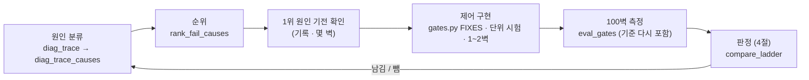

# 실험 파이프라인: 실패 원인을 하나씩 없애며 검측 단계별 효과 재기 (2026-11-10)

> 계획 · 진행 문서다. 단계가 끝날 때마다 5절 표와 결과를 이어 쓴다.
> - 숫자는 모두 개발 시작값 700300 ~ 700399(100벽) 결과다. **최종 평가가 아니다.** 최종 숫자는 설정을 고정한 뒤 시험 시작값(730000번대)으로 한 번 낸다. 730000번대는 사용 허락이 필요하다.
> - 참값(시뮬레이터 정답 좌표)은 실패 분류 · 채점에만 쓴다. 제어 판단에는 쓰지 않는다.
> - 관련 문서: [최종 마무리 로드맵](로드맵_최종마무리_20261110.md) · [성능 개선 스토리라인](성능개선_스토리라인.md) · [개선 상한 추정](근거_우분투_wall3_검측정보진단_20261103/개선상한_추정_20261110.md) · [남은 실패 원인 분석 11-05](근거_우분투_wall3_검측정보진단_20261103/남은실패_원인분석_20261105.md)

## 0. 한눈에

| | 내용 |
|---|---|
| 연구 질문 | 검측 단계(G1 · G2 · G3와 이번에 더하는 제어)가 **각각 성능을 얼마나 올리나** (ablation) |
| 방법 | 교수님 피드백 ⑦대로 한다. 실패 원인을 나누고, 없앴을 때 기대 향상이 큰 것부터 하나씩 제어를 단다. 같은 100벽에서 짝지어 비교하고, 다시 나눈다 |
| ablation과의 관계 | 새 제어는 모두 켜고 끌 수 있다(기본값 꺼짐). 하나 넣을 때마다 ablation 표에 한 줄이 생긴다 |
| 출발점 | E3 = ACT + G1 · G2 · G3, 기준 자리 = 손에 든 벽돌: **8.55장** (53 %), 16장 완성 12벽 |
| 목표 | 채움률 80 % 이상 (12.8장 이상) |

## 1. 실패 원인 9개와 기대 향상 (E3 100벽 추적, 11-04 기록)

- **기대 향상**: 그 원인의 처음 실패를 100 % 없앴다고 볼 때 오르는 장 수다. 자리별 처음 실패 비율로 계산하고, 자리 사이는 독립이라고 본다.
- **누적**: 위에서부터 차례로 없앴을 때의 값이다.
- 한 원인이 사라지면 그 뒤 자리까지 가는 벽이 늘어난다. 그래서 같은 11벽이라도 앞 자리 원인(자리 6)보다 뒤 자리 원인(자리 7)의 향상이 클 수 있다.
- 계산은 상한 쪽이다. 실제 제어는 원인을 일부만 없애고, 3단(자리 12 ~ 15)은 그 자리까지 간 벽이 12벽뿐이다.

출처: `sim/wall3/rank_fail_causes.py` → `sim/outputs/wall3/rank_fail_causes_20261110.json` (sha256 앞 16자리 c62dd459f60ec758)

| 순위 | 원인 | 처음 실패 벽 | 그것만 없애면 | 누적 (채움률 · 16장 완성) | 기전 |
|---|---|---|---|---|---|
| 1 | **R_10S** 자리 10 반장: 정책이 집으러 내려오다 손가락으로 침 | 21 | +0.95장 | 9.3장 (58 % · 27 %) | 정책이 반장 중심에서 3 ~ 4 cm 벗어난 곳으로 빠르게 내려옴 (2절) |
| 2 | **R_7G** 자리 7: G2가 손 안 벽돌을 잘못 재 놓아 이웃 끝에 걸침 | 13 | +0.64장 | 10.3장 (64 % · 36 %) | 13벽 모두 손 안 측정 오차 12 ~ 28 mm. 벽돌을 중심에서 36 mm 넘게 벗어나 쥠 · 6개 시점 중 2개만 보임. G3도 못 봄 |
| 3 | **R_7C** 자리 7: 정책이 옮기다 떨어뜨림 | 11 | +0.54장 | 11.1장 (69 % · 43 %) | 확인 안 함. 자리 7 벽돌은 대개 중심에서 약 35 mm 벗어나 쥐어짐 |
| 4 | **R_7S** 자리 7: 공급대에서 집다 기울어 떨어짐 | 9 | +0.44장 | 11.7장 (73 % · 50 %) | 손 방향이 벽돌과 약 8° 어긋남 (채운 벽은 약 2°) |
| 5 | R_1단 자리 1 ~ 4 여러 원인 | 7 | +0.43장 | 12.4장 (78 % · 53 %) | 섞여 있음 |
| 6 | **R_6G** 자리 6: 자리 5 반장이 어긋나 있어 놓다 부딪힘 | 11 | +0.40장 | 13.4장 (84 % · 61 %) | 확인함: G2가 반장을 못 보고 기본값으로 놓음 → G3가 41 mm 넘게 어긋난 8번을 못 봄 (찾는 반경 40 mm) |
| 7 | R_5 자리 5 반장 | 7 | +0.29장 | 14.1장 (88 % · 66 %) | 섞여 있음 |
| 8 | R_11 자리 11 | 5 | +0.25장 | 15.5장 (97 % · 94 %) | 섞여 있음 |
| 9 | R_기타 | 4 | +0.17장 | 16장 | – |

## 2. 원인별 제어

| 제어 | 이름 | 겨냥 | 하는 일 | 쓰는 정보 | 근거 · 사전 확인 | 상태 |
|---|---|---|---|---|---|---|
| **K1** | G1 뒤 철수 복귀 | R_10S | G1이 '안 쥠'으로 판정하면 집게를 열고 5 cm 든 뒤, 철수 자세(시연의 시작 자세)로 보내고 돌려준다. 롤아웃은 이것을 정책의 철수로 세지 않는다 | 관절값 | 근거: 처음 실패 39개 중 23개가 G1이 손을 돌려준 1.5 s 안에 일어났다. **1벽 확인(700323)**: 철수 자세에서 출발해도 정책이 반장 중심에서 39 mm 벗어나 내려와 쳤다 → 가설이 약해짐 | **L1 남김** (+0.95장 [+0.10, +1.80]) |
| **K2** | G0 집기 정렬 | R_10S (R_7G · R_7C · R_7S도 겨냥, 아래 추론) | 정책이 집게를 연 채 공급칸 중심 6 cm 안, 접근 높이 + 3 cm 아래로 내려오면 가로챈다. 도면의 공급칸 중심 · 방향으로 대본과 같은 집기 동작을 한 뒤 G1 판정을 하고 돌려준다. 공급칸마다 2번까지, 이미 집은 칸은 다시 안 함 | 도면(공급칸 배치) + 관절값 | 사전 확인: 대본 동작으로 10벽 × 16장을 도면 중심에서 집으니 G1 '쥠' 160 / 160, 손 안 어긋남 길이 ≤ 10.7 mm · 폭 ≤ 5.1 mm, 이웃 움직임 0.1 mm 이하. **정책과 2벽 확인 (700323 · 700314)**: 둘 다 16장 완성, G0 32번 모두 G1 '쥠'. 정책이 내려온 위치는 중심에서 3 ~ 51 mm | **L1 남김** (+4.72장 [+3.70, +5.72]) |
| **K6** | G3 넓게 찾기 | R_6G | G3가 놓인 벽돌을 찾는 반경을 4 → 7 cm로 넓힌다. 이웃 벽돌 중심은 15 cm 이상 떨어져 있다 | top 카메라 | 확인: 자리 5 반장을 G2가 못 본 25번 중 G3가 못 본 8번은 모두 41.5 ~ 48.1 mm 어긋남. 40.6 mm 이하 17번은 모두 G3가 보고 다시 놓았다 | **L1 보류** (+0.32장 [−0.23, +0.89]) → L2에서 K2와 함께 다시 잼 |
| K3 (예정) | G2 측정 신뢰 검사 | R_7G | 손 안 벽돌이 6개 시점 중 2개 이하에서만 보였거나, 목표 위에서 다시 재지 못하면 시점을 더 쓴다. 그래도 안 되면 다시 쥐게 한다 | top 카메라 | G2 카메라 측정 1102번: 시점 ≤ 2개면 37번 중 26번이 5 mm 넘게 틀림. 3개 시점이 보이면 1065번 중 32번 | K2 결과를 보고 정함. K2가 손 안 어긋남을 줄이면 저절로 줄 수 있음 |
| K4 (예정) | 놓기 이른 접촉 감지 (제안 SDCG (c)) | R_7G · R_6G (걸침 · 부딪힘) | G2가 내려놓을 때 손목 힘 센서로 예상보다 일찍 닿으면 멈추고 들어 올려 다시 잰다 | 손목 힘 · 토크 센서 | 걸침은 받침보다 약 57 mm 높은 곳에서 먼저 닿음(기하) | 설계만 |
| K5 (예정) | – | R_7C | 기전 확인 먼저 | – | – | K2 뒤에도 남으면 |
| – | – | R_1단 · R_5 · R_11 · R_기타 | 다시 분류한 뒤 정함 | – | – | – |

**공통 뿌리 (추론)**: 1 ~ 4위가 모두 "정책이 공급대 벽돌을 중심에서 3 ~ 4 cm 벗어나게 겨누고 쥔다"는 데서 나왔을 수 있다.
- 시연(대본)은 늘 벽돌 중심을 쥔다.
- 정책의 겨눔 · 쥠 어긋남:
  - 자리 10: 중앙 36 / 31 mm
  - 자리 7: 약 35 mm
  - 자리 7 손 방향: 8°
- G2가 잘못 잰 경우는 모두 |어긋남| ≥ 33 mm였다. |어긋남| < 10 mm에서는 866번 중 2번뿐이다.
- 그래서 K2 하나로 여러 원인이 함께 줄 수 있다. 원인별로 줄었는지는 L1 추적으로 다시 나눠 확인한다.

**역할 분담이 바뀐다**: K2를 남기면 정책이 맡던 "마지막 몇 cm 집기"를 검측이 맡게 된다.
- 정책: 어느 벽돌로 갈지, 접근, 운반
- 검측: 집기 정렬, 놓기 정밀도, 검사
- 발표의 분업 설명과 ⑧ 모방학습 방어(로드맵 6절)를 이에 맞춰 고친다.

## 3. 한 단계에서 하는 일

1. **원인 분류**: 남긴 설정으로 100벽을 추적 기록과 함께 다시 돌린다(`diag_trace`). 그다음 `diag_trace_causes`로 나누고 `rank_fail_causes`로 순위를 매긴다. 새로 생긴 (자리, 묶음)은 '(새로 생김)'으로 따로 센다.
2. **기전 확인**: 1위 원인이 실제로 어떻게 일어났는지 기록에서 따라간다. 필요하면 몇 벽만 다시 돌린다. 사실과 추론을 나눠 적는다.
3. **제어 구현**: `sim/wall3/gates.py`의 `FIXES`에 이름 하나로 넣는다. 기본값은 꺼짐이다. `sim/tests/test_wall3_gate_fix.py`에 시험을 더하고, 기존 시험이 모두 통과해야 한다. 1 ~ 2벽으로 의도대로 동작하는지 본다.
4. **100벽 측정**: `eval_gates --conditions <기준> <기준>+<새 제어> ...`. 같은 묶음에 기준을 다시 넣어 실행 간 흔들림을 함께 잰다. 감독(`wall3.supervisor --plan ...`)이 돌린다.
5. **판정**: 4절. `compare_ladder`로 짝 비교한다.
6. **기록**: 이 문서 5절, 보고서, [스토리라인](성능개선_스토리라인.md)을 갱신하고 커밋한다.

## 4. 판정 기준 (결과를 보기 전에 정함. 보고 나서 바꾸지 않는다)

| 항목 | 기준 |
|---|---|
| 주 지표 | 벽당 채운 자리 (평가지표 md 그대로). 16장 완성 벽 · 시방 합격을 함께 적는다 |
| 남김 | 같은 묶음 기준 대비 짝 차이의 **95 % 구간 하한 > 0** (벽 단위 부트스트랩 10000번) |
| 뺌 | 구간 상한 < 0 (해가 됨) |
| 보류 | 구간이 0을 걸침. 겨냥한 원인의 처음 실패 벽이 절반 아래로 줄고 다른 원인이 늘지 않았으면, 다음 단계에서 다른 제어와 함께 다시 잰다. 아니면 뺀다 |
| 원인 하나에 시도 | 제어 2개까지. 둘 다 안 되면 "이 원인은 검측 제어로 못 없앰"으로 기록한다(ablation 결과의 일부) |
| 흔들림 참고 | 100벽 짝 비교의 95 % 구간 폭은 약 ±0.8장이다(E3 대 E2 참값 (진단): +0.22 [−0.62, +1.06]). 같은 조건을 다시 돌리면 0.17장 차이, 40벽이 달라졌다 |

## 5. 실행 단계와 결과

| 단계 | 조건 (ACT, 100벽) | 출력 (`sim/outputs/wall3/`) | 상태 · 결과 |
|---|---|---|---|
| L0 | E3 (11-04) | `eval_gates_info_20261104` | 8.55장, 완성 12, 시방 11 |
| **L1** | E3 다시 · E3+K1 · E3+K2 · E3+K6 (하나씩) → E3+K2 추적 · 분류 · 순위 | `eval_ladder1_20261110`, `eval_ladder1_20261110_compare.json`, `diag_trace_ladder1_k2_20261110/` | 평가 끝 (11-10 15:13 ~ 16:25). **K1 남김 · K2 남김 · K6 보류** (5.1절). 추적 · 분류 · 순위는 16:26 시작 |
| L2 | L1에서 남긴 것 + 다시 매긴 1위 원인의 제어 | – | L1 판정 뒤 |
| L3 … | 같은 방식 | – | – |
| Lf | 최종 설정과, 거기서 제어를 하나씩 뺀 조건 (leave-one-out) | – | 설정 고정 전 |
| 최종 | 6절 표 전체, 730000번대 1회 (**허락 필요**) | – | – |

### 5.1 L1 결과 (11-10, 평가 끝)

같은 100벽(700300 ~ 700399), ACT, 카메라 위치, 기준 자리 = 손에 든 벽돌. 기준은 같은 묶음에서 다시 돌린 E3다. 개발 시작값이며 최종 평가가 아니다.

| 조건 | 벽당 채운 자리 | 채움률 | 16장 완성 | 시방 합격 | 기준 대비 짝 차이 [95 % 구간] | 늘어난 벽 · 줄어든 벽 | 판정 (4절) |
|---|---|---|---|---|---|---|---|
| E3 다시 (기준) | 8.58장 | 53.6 % | 12 | 12 | – | – | – |
| E3 (11-04, L0) | 8.55장 | 53.4 % | 12 | 11 | −0.03 [−0.58, +0.52] | 25 · 19 | 같은 조건 다시 돌림: 흔들림 확인 |
| E3 + K1 | 9.53장 | 59.6 % | 25 | 24 | **+0.95 [+0.10, +1.80]** | 44 · 27 | **남김** |
| E3 + K2 | **13.30장** | **83.1 %** | **59** | **59** | **+4.72 [+3.70, +5.72]** | 73 · 14 | **남김** |
| E3 + K6 | 8.90장 | 55.6 % | 12 | 10 | +0.32 [−0.23, +0.89] | 30 · 14 | **보류** (아래) |
| (진단) E2, 위치 = 참값 (진단) (11-04) | 8.77장 | 54.8 % | 11 | 9 | +0.19 [−0.59, +0.98] | 39 · 33 | 참고 |

**자리별 처음 실패 비율** (그 자리까지 간 벽 중 거기서 처음 실패한 벽, 0.05 이상만):

| 조건 | 자리 5 | 자리 6 | 자리 7 | 자리 10 | 자리 11 | 그 밖 |
|---|---|---|---|---|---|---|
| E3 다시 | 9 / 92 = 0.10 | 12 / 83 = 0.14 | 29 / 71 = **0.41** | 24 / 41 = **0.59** | 3 / 17 = 0.18 | 자리 12 · 13: 0.07 · 0.08 |
| E3 + K1 | 0.03 | 0.04 | 40 / 82 = 0.49 | 9 / 42 = **0.21** | 7 / 33 = 0.21 | 자리 2: 10 / 99 = 0.10 (기준 0.04) |
| E3 + K2 | 0 | 10 / 98 = 0.10 | 1 / 88 = **0.01** | 0 / 85 = **0** | 24 / 85 = **0.28** | – |
| E3 + K6 | 0.09 | 4 / 85 = **0.05** | 39 / 81 = 0.48 | 21 / 40 = 0.53 | 5 / 19 = 0.26 | 자리 2: 0.05 |

**사실**
- K2: G0가 공급칸 1391번을 대신 집었다. 그중 1380번(99.2 %)이 G1 '쥠'이었다. 정책이 내려온 위치는 공급칸 중심에서 중앙값 21.7 mm 벗어나 있었다.
- K2에서 자리 7 · 자리 10의 처음 실패가 거의 사라졌다(29 → 1벽, 24 → 0벽). 남은 처음 실패는 자리 11(24벽)과 자리 6(10벽)이 대부분이다.
- K2에서 걸친 채 채운 것으로 세어진 벽돌(filled_but_perched)은 1개다(기준 11개).
- K1은 자리 10 처음 실패를 0.59 → 0.21로 줄였다. 자리 2 처음 실패는 0.04 → 0.10으로 늘었다(4 → 10벽).
- 같은 E3를 다시 돌린 차이는 −0.03장 [−0.58, +0.52]다. 44벽이 달라졌다.

**K6 보류 근거**: 4절 '보류' 조건으로 판단했다.
- 겨냥한 자리 6 처음 실패: 12 → 4벽. 절반 아래로 줄었다.
- 다른 원인이 늘었는지는 자리별 처음 실패 **비율**로 봤다. 벽 수는 앞 자리가 줄면 저절로 늘기 때문이다. 이 해석은 L1 결과를 본 뒤 정했으므로 여기 밝혀 둔다.
- 자리 7 비율은 0.41 → 0.48이다. 두 비율 차이의 표준오차는 약 0.08이라 잡음 안으로 본다. 나머지 자리는 늘지 않았다.
- 그래서 L2에서 K2와 함께 다시 잰다.

**추론 (확인 전)**
- 2절의 "공통 뿌리"와 맞는다. 집기를 도면 중심으로 맞추니 자리 7 · 10의 원인(1 ~ 4위)이 함께 줄었다. 원인별로 줄었는지는 L1 추적(`diag_trace_ladder1_k2_20261110`)으로 확인한다.
- K1의 자리 2 증가가 K1 때문인지 흔들림인지는 아직 모른다.

## 6. 최종 ablation 표 (연구 목적: 검측 단계별 성과의 정량 분석)

| 줄 | 조건 | 지금 있는 개발 값 (700300번대) |
|---|---|---|
| 1 | 검측 없음 | 2.00장 |
| 2 | G1 | 4.17장 |
| 3 | G1 + G2 / G1 + G3 / G2 + G3 (기준 자리 = 차례 번호) | 7.41 / 5.91 / 4.14장 |
| 4 | G1 + G2 + G3 (차례 번호) | 5.21장 |
| 5 | G1 + G2 + G3 (손에 든 벽돌 = E3) · 둘씩 조합 | 8.55장 · 7.50 / 8.18 / 8.19장 |
| 6 | E3 + 남긴 추가 제어를 하나씩 쌓은 사다리 | L1: +K1 9.53 · **+K2 13.30** · +K6 8.90장 (하나씩, 5.1절) |
| 7 | 최종 설정에서 하나씩 뺀 조건 | Lf |
| (진단) | 같은 조건, 위치 = 참값 (진단) | E2 8.77장 |

- 열: 벽당 채운 자리, 16장 완성, 시방 합격, 처음 실패 원인 분포.
- 정책: ACT. Diffusion은 시간이 되면 같은 표로 낸다.

## 7. 지킬 것

- 시작값은 700300 ~ 700399만 쓴다. 730000번대는 최종 1회만 쓰며, 사용 허락이 필요하다. 720000번대는 쓰지 않는다.
- 출력 폴더는 덮어쓰지 않는다. 끊긴 실행은 `_STOPPED_n`으로 남기고 합치지 않는다.
- 제어는 기본값 꺼짐으로 둔다. 기존 조건의 동작은 바뀌지 않는다(시험으로 확인).
- 제어가 쓰는 정보는 관절값 · 손목 힘 센서 · 집게 각도 · top 카메라 · 도면뿐이다. 참값은 기록에만 쓴다.
- 평가 기준은 바꾸지 않는다.

## 8. 기록

| 항목 | 값 |
|---|---|
| 제어 구현 | commit c3e0016 (`sim/wall3/gates.py` FIXES k1 · k2 · k6, `rollout.py --gate-fix`, `eval_gates` 조건 이름 `all_held+k2`) |
| 시험 | `sim/tests/test_wall3_gate_fix.py` 8개, wall3 시험 전체 42개 통과 (c3e0016 커밋 메시지의 "47개"는 잘못 쓴 값) |
| 원인 순위 | `rank_fail_causes_20261110.json` c62dd459f60ec758 |
| 도면 중심 집기 사전 확인 | `diag_nominal_grasp_20261110.json` afc5298a524688d2 (높이를 도면에서 읽게 고친 뒤 다시 돌린 `_20261110b`도 같은 값) |
| L1 평가 | commit c3e0016에서 실행, `eval_ladder1_20261110/summary.json` 249b09bf7439d595, `plan.json` ad0009d63d0acd5c, 비교 `eval_ladder1_20261110_compare.json` d81452ae8fa8da5a (env main_v1_eval, ACT `main_train_v2_20261022/act_s1000` last, 실패 작업 0) |
| 1 ~ 2벽 확인 | 700323 E3+K1+K6: 10장 (자리 10에서 다시 침). 700323 · 700314 E3+K2: 16장 · 16장 (추적, 스크래치에만 있음. 결과로 쓰지 않음) |
