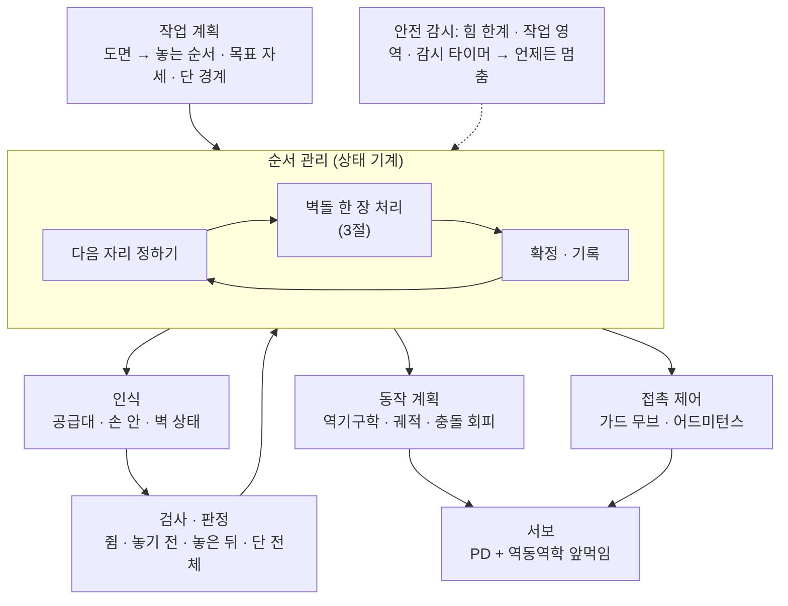
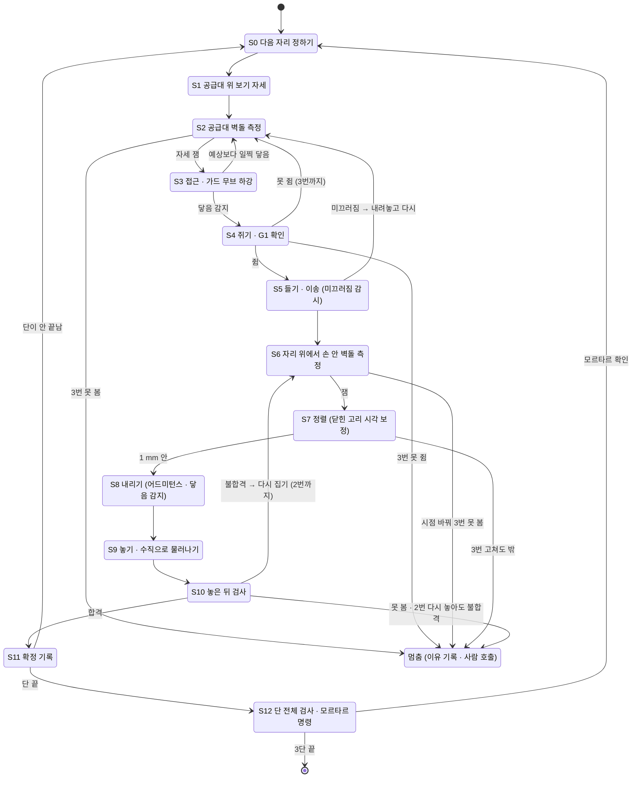
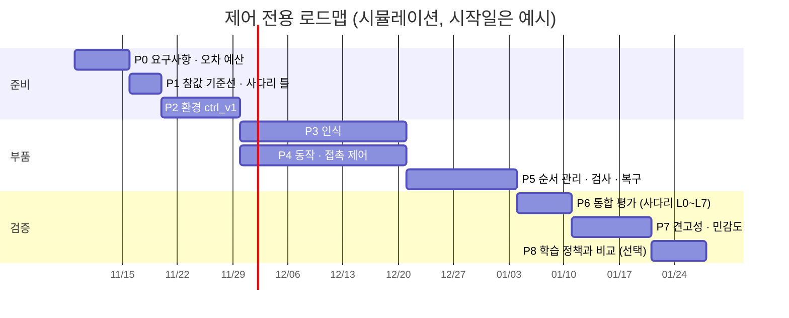

# 학습 없이 제어만으로 3단 벽 쌓기: 구현 로드맵 (2026-11-02)

> 계획 문서다. 이 문서를 쓰면서 코드와 환경은 하나도 바꾸지 않았다. 그림이 들어간 같은 내용: [`로드맵_제어만_자동화.html`](로드맵_제어만_자동화.html) (내려받아 브라우저로 열기).
> 처음 나오는 어려운 용어는 그 자리에서 짧게 풀고, 9절에 모아 다시 설명한다.

## 0. 한눈에

- **출발점**: 우리는 이미 제어만으로 벽을 쌓는 프로그램을 갖고 있다. 시연 데이터를 만든 대본(`sim/wall3/expert.py`)이다. 다만 대본은 시뮬레이터의 **참값**(벽돌의 실제 위치·자세 정답)을 세 군데에서 읽는다.
- **할 일**: 그 세 군데를 센서로 바꾼다. 그리고 참값 덕분에 필요 없던 것들을 새로 만든다. 실패했을 때의 처리, 모르타르 공정, 카메라 보정, 센서 잡음이 그것이다.
- **방법**: 참값을 한 곳씩 센서로 바꾸며 매번 100벽을 잰다(4절의 '사다리'). 어디서 정확도를 잃는지 한 단계씩 드러난다.
- **기간**: 시뮬레이션 안에서 약 3개월(1명 + Claude Code 기준). 학습이 없으니 GPU 학습은 필요 없다.
- **환경**: 지금 환경은 학습용이라 그대로 쓸 수 없다. 카메라 구성, 공급 방식, 모르타르, 차례 넘김 규칙, 센서 잡음을 바꿔야 한다(5절).

---

## 1. 출발점: 대본은 이미 '제어만으로' 벽을 쌓는다

### 1.1 대본이 하는 일

| 순서 | 대본 동작 | 쓰는 기법 |
|---|---|---|
| 1 | 철수 자세에서 출발해 공급 칸 0.10 m 위로 접근 | 역기구학 + 최소 저크 곡선 |
| 2 | 내려가 집기 → 들기 | 위치 제어. 집게는 0.5 s에 걸쳐 닫음 |
| 3 | 벽 자리 위로 이동, 놓기 직전 위치 보정 | **참값으로 손 안 벽돌 위치를 읽고 보정** |
| 4 | 놓기 → 올라가기 → 철수 자세 | 위치 제어 |
| 전체 | 관절 목표 = 원하는 궤적 + 역동역학 앞먹임 | UR10e 위치 서보(PD, kp 5000 · kd 500)의 처짐과 지연을 미리 보정 |

- **역기구학**: 손을 원하는 위치·방향에 두려면 관절 6개를 각각 몇 도로 해야 하는지 거꾸로 계산하는 것.
- **역동역학 앞먹임**: 팔이 그 궤적을 따라가는 데 필요한 힘을 미리 계산해서 명령에 더해 주는 것. 서보가 오차를 본 뒤에야 따라가는 지연을 줄인다.

**성적** (참값 사용):

| 항목 | 값 |
|---|---|
| 파일럿 50벽 | 모두 완주 |
| 시방 측정값 중앙값 | ② 0.81 mm · ③ 1.15 mm · ④ 0.96 mm |
| 벽돌 한 장 시간 | 중앙값 8.5 s |
| 본 수집 | 합격 벽 1000개 |

([실험일지 10-15~16](../../실험일지.md), [파일럿 보고서](../근거_우분투_wall3_파일럿/보고서.md))

이것이 제어만으로 갈 때의 **상한**이다. 센서는 참값보다 정확할 수 없다.

### 1.2 대본이 참값을 읽는 곳

| # | 대본이 읽는 참값 | 쓰는 곳 | 바꿀 센서 |
|---|---|---|---|
| 참1 | 공급대 벽돌의 위치·방향 | 집기 목표 | **새로 필요**: 손목 RGB-D 근접 보기 |
| 참2 | 손에 든 벽돌의 위치·방향 | 놓기 직전 보정 | **있음**: G2 방식(top RGB-D) |
| 참3 | 손 안 미끄러짐, 충돌 | 이상하면 중단 | 손목 힘 센서 + 카메라 (새로 필요) |

참값 덕분에 대본에 없던 것도 있다.

| 없던 것 | 대본에서 | 제어만으로 갈 때 |
|---|---|---|
| 실패 처리 | 실패하면 벽을 멈춤(재시도 없음) | 재시도와 정지 규칙(상태 기계) |
| 놓은 뒤 확인 | 하지 않음 | 검사하고 확정한 뒤 다음 벽돌 |
| 모르타르 | 환경이 조건을 보고 저절로 깔아 줌 | 공정으로 명령 |
| 카메라 보정 | 카메라 위치를 오차 없이 앎 | 손-눈 보정과 보정 오차 |
| 센서 잡음 | 깊이 값에 잡음 없음 | 잡음 모델 |

### 1.3 이미 만든 부품

| 부품 | 파일 | 확인된 성능 (시뮬레이션, 잡음 없음) | 제어 전용에서 |
|---|---|---|---|
| G1 쥠 확인 (손목 힘 + 집게 각도) | `wall3/g1.py` | 100벽 10,115회 판정 중 오판 4회 | 그대로 |
| 벽돌 자세 추정 (top 1280×960 RGB-D) | `wall3/perception.py` | 놓인 벽돌 오차 중앙값 0.2 mm, 95% 0.8 mm | 잡음을 넣고 다시 검증 |
| G2 손 안 측정 + 보정 | `wall3/gates.py` | 차례 1·2에서 놓은 뒤 오차 중앙값 0.5~0.7 mm | 닫힌 고리로 바꿈(지금은 1회 측정 뒤 다시 재서 기록만 함) |
| G3 놓은 뒤 검사 + 다시 놓기 | `wall3/gates.py` | 다시 놓은 81회: 참값 오차 중앙값 0.35 mm, 95백분위 39.6 mm(일부는 크게 실패). 검사 243회 중 못 봄 9% | 못 보면 멈춤, 재시도 한도 |
| 시방 채점 (참값) | `wall3/spec_metrics.py` | 시험 14건 | 그대로(채점에만 참값) |

---

## 2. 전체 구조

| 층 | 하는 일 | 대표 기법 (9절 용어) | 우리 코드 |
|---|---|---|---|
| 작업 계획 | 도면에서 놓는 순서, 자리별 목표 자세, 단 경계를 만듦 | 순서표 | `design_slots()` 있음 |
| 순서 관리 | 지금 무엇을 할지, 언제 다음으로 넘어갈지, 실패하면 무엇을 할지 | 상태 기계, 인터록 | **새로**. 지금 rollout은 17 s나 철수 자세 복귀로 넘김 |
| 인식 | 벽돌이 어디 있는지 잼 | RGB-D, 평면 맞춤, 모델 정합 | top은 있음. 공급대는 새로 |
| 동작 계획 | 손을 어디로 어떻게 옮길지 | 역기구학, 최소 저크 곡선 | 대본의 이동 함수 있음 |
| 접촉 제어 | 닿는 순간을 힘으로 다룸 | 가드 무브, 어드미턴스 | **새로** |
| 서보 | 관절 목표 따라가기 | PD + 역동역학 앞먹임 | 있음 |
| 검사 | 각 단계가 끝났는지 센서로 판정 | 문턱 판정 | G1·G3 있음 |
| 안전 감시 | 위험하면 멈춤 | 페일세이프, 감시 타이머 | **새로** |

원칙은 세 가지다.

1. **판단에는 로봇이 실제로 가진 정보만 쓴다**: 관절값, 힘 센서, 카메라, 도면. 참값은 채점과 감사에만 쓴다(지금 원칙과 같음).
2. **확인 못 하면 진행하지 않는다** (페일세이프): 못 봄, 못 쥠, 불합격이 재시도 한도를 넘으면 그 벽을 멈추고 이유를 기록한다. 현장이라면 사람을 부르는 지점이다.
3. **다음 차례는 순서 관리가 정한다**: 시간이 지났다고 넘어가지 않는다. 앞 자리가 카메라로 확정돼야 다음 자리로 간다.

---

## 3. 벽돌 한 장의 흐름 (상태 기계)

**상태 기계**: 로봇이 지금 어느 '상태'(단계)에 있는지와, 어떤 조건에서 어느 상태로 옮겨 가는지를 표로 정해 둔 것. 모든 경우를 미리 정하므로 예상 못 한 동작이 없다.

| 상태 | 들어가는 조건 | 쓰는 센서 · 정보 | 나가는 조건 | 실패하면 | 지금 코드 |
|---|---|---|---|---|---|
| S0 다음 자리 | 시작 또는 앞 자리 확정 | 확정 기록, 도면 | 확정 안 된 첫 자리 j | - | 새로 |
| S1 보기 자세 | j 정해짐 | 공급 칸 배치표(도면) | 칸 j 위 15 cm 도착 | 역기구학 실패 → 멈춤 | 대본 이동 함수 |
| S2 공급대 측정 | 보기 자세 | 손목 RGB-D | 벽돌 자세(위치 · 방향) | 높이를 바꿔 다시. 3번 → 멈춤 | **새로** (지금 손목은 128 컬러) |
| S3 접근 · 하강 | 자세 잼 | 관절값, 손목 힘 | 바닥 쪽 힘이 문턱 넘음(닿음) | 예상 높이보다 2 cm 일찍 닿음 → 올라가 S2 | 새로 (대본은 정해진 높이까지 내려감) |
| S4 쥐기 · 확인 | 닿음 | 집게 각도, 손목 힘 | G1 '쥠' | 열고 S2. 3번 → 멈춤 | **G1 있음** |
| S5 이송 | 쥠 | 손목 힘(무게 변화), 손목 카메라 | 자리 위 보기 높이 도착 | 무게가 사라지거나 손 안 위치가 변함 → 안전한 곳에 내려놓고 S2 | 새로 (대본은 참값으로 감시) |
| S6 손 안 측정 | 보기 높이 | top RGB-D | 손 안 벽돌 위치 · 방향 | 시점 바꿔 3번 → 멈춤 | **G2 있음** |
| S7 정렬 | 잼 | top RGB-D | 남은 오차 1 mm 안 | 잴 때마다 고치기 3번 → 멈춤 | G2는 1번만 고침 → 닫힌 고리로 |
| S8 내리기 | 정렬 | 손목 힘 | 받침(모르타르)에 닿음 | 닿는 높이가 예상과 5 mm 넘게 다름 → 올라가 S6 | 새로 (G2는 잰 높이 0.5 mm 위까지 위치로 내려감) |
| S9 놓기 | 닿음 | 집게 | 손이 5 cm 위로 물러남 | - | 있음 |
| S10 검사 | 물러남 | top RGB-D (팔 비킴) | 허용치 안 | 불합격: 다시 집어 S6 (2번). 못 봄: 시점 바꿈 → 멈춤 | **G3 있음** (지금은 못 보면 그냥 넘어감) |
| S11 확정 | 합격 | - | 기록 | - | 새로 |
| S12 단 검사 · 모르타르 | 단의 마지막 확정 | top RGB-D | 단 전체 합격 → 모르타르 명령 → 판 높이 잼 | 앞에서 확정한 벽돌이 밀림 → 그 자리로 S6 | 새로 |
| 안전 감시 | 항상 | 힘, 관절 속도, 시간 | - | 힘 한계 초과, 작업 영역 밖, 상태별 시간 초과 → 멈춤 | 새로 |

- 재시도 횟수(3번, 2번)와 허용치(1 mm)는 초안이다. 6단계(통합 평가)에서 실패 기록을 보고 정한다.
- '멈춤'은 시뮬레이션에서 그 벽을 끝내고 이유를 남기는 것이다. 멈춘 벽 수와 이유가 중요한 결과 지표가 된다.

---

## 4. 방법: 참값을 한 곳씩 센서로 바꾸는 사다리

한 번에 여러 개를 바꾸면 성적이 떨어졌을 때 어디서 떨어졌는지 모른다(지금 학습 분석에서 겪은 문제). 그래서 한 칸씩 내려가며 칸마다 100벽을 잰다.

| 칸 | 바꾸는 것 | 나머지 | 보는 것 |
|---|---|---|---|
| L0 | 없음 (지금 대본, 참값) | - | 상한 |
| L1 | 공급대 벽돌 자세 → 손목 RGB-D | 참값 | 집기 실패율, 손 안 어긋남 |
| L2 | + 손 안 벽돌 자세 → top RGB-D (G2 방식) | 참값 | 놓기 오차 |
| L3 | + 놓을 기준(앞 단 실제 윗면 · 이웃 벽돌) → top RGB-D | 참값 | 줄눈 ① · 수평선 ② |
| L4 | + 미끄러짐 · 충돌 감시 → 힘 센서 · 카메라 | - | 놓친 이상 |
| L5 | + 센서 잡음 · 보정 오차 '보통' | - | 시방 합격률 |
| L6 | + 공급대 흩어짐 (지그 없음) | - | 집기 |
| L7 | + 실패 주입 | - | 복구율, 멈춤 이유 |

**실패 주입 시험**: 일부러 문제를 넣어 복구 규칙이 작동하는지 보는 시험이다. 넣을 문제는 다음과 같다.

- 공급 벽돌을 2 cm 옮겨 두기
- 이송 중 손 안 벽돌을 5 mm 밀기
- 놓인 벽돌을 3 mm 밀기
- 카메라 한 장 가리기
- 모르타르 판을 3 mm 높이기

---

## 5. 환경은 어떻게 달라야 하나

지금 환경(`main_v1` 학습용, `main_v1_eval` 평가용)은 **정책에게 시연을 보여 주고 정책을 시험하기 위한 환경**이다. 제어 전용 환경 `ctrl_v1`(가칭)은 아래처럼 달라야 한다.

### 5.1 바꿔야 하는 것

| # | 항목 | 지금 | 제어 전용 (`ctrl_v1`) | 이유 |
|---|---|---|---|---|
| E1 | 정책용 카메라 (front · top · wrist, 128×128 컬러) | 정책 입력 | **필요 없음.** 녹화용으로만 둠 | 정책이 없음. 128 px는 벽 근처 한 화소 약 1 cm라 측정에 못 씀 |
| E2 | top 카메라 | 같은 카메라를 1280×960 RGB-D로도 렌더(검측용) | **주 측정 카메라.** 깊이 잡음, 보정 오차 추가 | 지금은 깊이에 잡음이 전혀 없어 0.2 mm가 나옴. 실제 카메라로는 기대하기 어려움 |
| E3 | 공급대를 보는 카메라 | **없음.** top 화면에 공급대가 들어오지 않음(대본은 참값으로 집음) | **손목 RGB-D(근거리형)** 추가 | 집기 목표(참1)를 잴 센서가 없음. 손목에 두면 현장에서 따로 설치할 필요가 없고, 가까이서 보니 정확함 |
| E4 | 공급 방식 | 칸마다 위치 ±10 mm, 방향 ±10° 흩어짐 | 기본은 **지그**(칸이 파인 받침대)로 ±2 mm · ±2°. 흩어짐은 사다리 L6에서만 | 전통 자동화는 환경을 정돈해 인식 부담을 줄임(구조화된 환경). 흩어짐도 버티는지는 따로 잼 |
| E5 | 모르타르 | 아래 단이 제자리(8 mm · 3 mm · 10° 안)에 2 s 멈추면 환경이 저절로 판을 깖. 10-30에 '공급대를 떠나면 깖' 버전도 추가 | **순서 관리가 명령하면 깖** (S12). 판 높이 편차(±1~2 mm) 추가 | 현실에서는 누가 언제 바를지가 공정이다. 판이 깔리는 조건을 환경이 몰래 정하면 안 됨 |
| E6 | 다음 차례로 넘기는 규칙 | rollout이 철수 자세 복귀 또는 17 s로 넘김 | **없앰.** 순서 관리가 확정 기록으로 정함 | 시간이 지났다고 넘어가면 잘못된 바닥 위에 쌓음(지금 하자 H3) |
| E7 | 시간 제한 | 벽돌당 17 s | 상태마다 감시 타이머 + 벽 전체 사이클 타임 기록 | 어느 상태에서 막혔는지 알아야 함 |
| E8 | 제어 주기 | 20 Hz 관절 목표(물리 50단계에 선형 보간) | 이동은 20 Hz 그대로. **접촉 구간(S3 · S8)은 500 Hz 경로** 추가 | 어드미턴스와 가드 무브는 힘을 빨리 봐야 함. 실제 UR10e e-Series도 500 Hz로 명령을 받음 |
| E9 | 힘 센서 | 손목 힘 · 토크(정책 입력 아님, G1만 씀) | 접촉 · 미끄러짐 감시에 씀. 잡음과 편향 추가 | 실제 센서는 잡음이 있고 영점이 흐름 |
| E10 | 손-눈 보정 | 카메라 위치 · 화각을 정확히 앎 | 보정 오차(위치 1~2 mm, 각도 0.1~0.2°) 추가. 보정 절차를 환경에 넣음 | 실제로는 보정해야 알고, 보정에도 오차가 있음 |
| E11 | 벽돌 치수 | 모두 설계 크기 | 치수 편차 추가 (10-06 소형 실험의 편차 설정 재사용 검토) | 실제 벽돌은 크기가 조금씩 다름. 길이 오차가 쌓이면 세로줄눈이 밀림 |
| E12 | 조명 · 색 | 고정 | 밝기 변화 | 인식이 벽돌 색(R − B ≥ 40)으로 걸러 내므로 조명에 약할 수 있음 |
| E13 | 시작값 | 정책 롤아웃 블록 700053~700199 · 700300~700399 | **제어 개발용 블록을 새로 정함.** 검증 720000+ · 시험 730000+는 최종에만 | 개발 중 튜닝이 시험 벽에 맞춰지는 것을 막음 |

### 5.2 바꾸지 않는 것

| 항목 | 이유 |
|---|---|
| 로봇(UR10e, 받침대 0.6 m) · 집게(2F-140 A1+) 모델 | 학습 결과와 비교하려면 같은 몸이어야 함 |
| 벽돌 물성, 모르타르 물성(침하 · 마찰), 쥔 동안 고정 조건 | 같은 물리 |
| 도면(16자리, 반장 2) · 공급 칸 배치 | 같은 과제 |
| 채점(참값, 시방 ①~⑤, IoU) | 같은 잣대. '채움'의 걸침 문제는 별도 결정 사항 |
| 참값은 채점 · 감사에만 | 연구 원칙 |

### 5.3 현장으로 갈 때 더 달라지는 것 (시뮬레이션 밖)

| 항목 | 내용 | 사례 |
|---|---|---|
| 로봇 위치 정합 | 로봇 받침대가 벽 기준선(먹선)에 대해 어디 있는지 잼. 이동할 때마다 다시 | SAM: 레이저가 기준 막대(story pole)의 표식을 찾고, 벽돌을 놓을 때마다 위치를 읽어 보정. Hadrian X: 레이저 트래커가 놓는 위치를 감시 |
| 공급 | 사람이나 컨베이어가 벽돌을 정해진 자세로 공급 | SAM: 컨베이어로 벽돌을 넣음 |
| 모르타르 | 벽돌마다 바르거나 접착제를 씀 | SAM: 집게가 벽돌에 모르타르를 바른 뒤 놓음. Hadrian X: 도포기에서 블록에 접착제를 바름 |
| 날씨 · 빛 | 햇빛 아래에서는 적외선을 쏘는 깊이 카메라가 약함. 바람과 진동도 있음 | Hadrian X: 진동 · 바람 보정(DST) |
| 사람 | 설치, 마감, 최종 품질 확인은 사람 몫 | SAM: 설치와 품질 확인은 석공이 함 |

---

## 6. 로드맵

P3과 P4는 같은 시기에 진행한다. 합계는 약 13주, 겹치는 기간을 빼면 약 11주다. 실물(P9)과 현장(P10)은 캡스톤 범위 밖이다.

### P0. 요구사항 · 오차 예산 (1주)

- **목표**: 무엇을 얼마나 정확히 할지 숫자로 정한다.
- **요구사항**: 시방 ①~⑤를 합격해야 한다.
  - ① 가로줄눈 7~13 mm, 1단 아랫면 0~3 mm
  - ② · ③ · ④ 6 mm
  - ⑤ 벽 두께 −6 ~ +13 mm

**오차 예산**: 벽돌 한 장을 놓는 오차를 원인별로 나눠 각각 얼마까지 허용할지 정한 표다. 아래는 초안이며 95% 기준이다.

| 원인 | 배정 | 근거 |
|---|---|---|
| 로봇 손 위치 (기구학 · 서보 추종) | 0.3 mm | UR10e 반복 정밀도 ±0.05 mm(제조사 사양) + 시뮬레이션 추종 오차 |
| 손-눈 보정 오차 | 0.8 mm | E10 |
| 손 안 벽돌 측정 | 0.8 mm | G2 방식, 잡음 있을 때 |
| 놓을 기준(앞 단 · 이웃) 측정 | 0.8 mm | top RGB-D |
| 놓는 순간 밀림 | 1.0 mm | 집게가 열리며 생김 |
| 모르타르 침하 편차 (높이) | 0.5 mm | 침하 1.06 mm 설계 |
| **합 (RSS)** | **약 1.8 mm** | 원인들이 서로 독립이라고 보고 제곱합의 제곱근 |
| 합 (모두 최악으로 겹칠 때) | 4.2 mm | 단순 합 |

- 벽돌 한 장 목표: **3 mm 이하(95%)**. 최악으로 겹쳐도 4.2 mm라 벽 단위 6 mm 안에 든다.
- 이 배정이 맞는지는 P7에서 잡음을 키워 가며 확인한다.

**산출물**: `요구사항_오차예산.md`. 통과 기준은 원인마다 '어떻게 잴지'가 정해지는 것이다.

### P1. 참값 기준선 · 사다리 틀 (0.5주)

- **할 일**:
  - 지금 대본을 지금 채점 기준으로 100벽 잰다(사다리 L0).
  - 참값을 읽는 세 곳(참1~3)을 바꿔 끼울 수 있게 측정 함수 자리를 나눈다. 대본 동작은 바꾸지 않는다.
- **산출물**: L0 성적표(시방 합격률, 항목별 중앙값 · 95백분위, 사이클 타임).
- **통과 기준**: L0 결과를 같은 실행에서 다시 재현할 수 있다.

### P2. 제어 전용 환경 `ctrl_v1` (1.5주)

- **할 일**: 5.1절 E1~E13을 넣는다.
  - 새 환경 버전으로 만들고, 옛 버전의 설정과 해시는 그대로 둔다.
  - 잡음은 '없음 / 보통 / 나쁨' 세 단계로 둔다.
- **산출물**: 환경 코드, 시험(옛 버전 해시 그대로, 잡음 통계가 설정과 일치, 지그 위치 분포).
- **통과 기준**:
  - 잡음 '없음'의 ctrl_v1에서 L0 대본 성적이 P1과 같다(참값 대본은 환경 개편의 영향을 받지 않아야 함).
  - 모르타르는 명령할 때만 깔린다.

### P3. 인식 (3주)

| 모듈 | 센서 | 방법 | 목표 (잡음 '보통', 95%) | 지금 |
|---|---|---|---|---|
| 3a 공급대 벽돌 | 손목 RGB-D, 칸 위 15 cm | 윗면 평면 맞춤 + 사각형 맞춤 → 위치 · 방향 | 1 mm · 1° | 새로 |
| 3b 손 안 벽돌 | top RGB-D, 자리 위 25 cm | G2 방식(보이는 모서리 + 알려진 크기) | 0.8 mm · 0.5° | 있음(잡음 없이 검증됨) |
| 3c 벽 상태 | top RGB-D, 팔 비킨 자세 | 놓인 벽돌 전부, 앞 단 윗면 높이, 모르타르 판 높이 | 0.8 mm | 놓인 벽돌은 있음, 판 높이는 G2에 일부 |
| 3d 손-눈 보정 | 보정판(체커보드) | 로봇이 보정판을 여러 자세로 보여 주고 카메라 위치를 계산 | 위치 1 mm · 0.1° | 새로 |

- **평면 맞춤**: 깊이 영상의 점들을 가장 잘 지나는 평면을 찾아 벽돌 윗면의 높이와 기울기를 얻는 것.
- **모델 정합**: 알고 있는 벽돌 모양(190×90×57 mm)을 측정된 점들에 겹쳐 가장 잘 맞는 위치를 찾는 것. ICP가 대표적이다.
- **감사**: 모든 측정을 참값과 비교해 오차 분포를 기록한다. 참값은 판단에 쓰지 않는다.
- **통과 기준**: 위 표의 목표. 각 모듈의 '못 봄' 비율도 함께 보고한다.

### P4. 동작 · 접촉 제어 (3주, P3과 같은 시기)

| 모듈 | 방법 | 통과 기준 |
|---|---|---|
| 4a 집기 하강 | 가드 무브: 천천히 내려가다 손목 힘이 문턱을 넘으면 멈춤 | 측정 오차 ±5 mm에서도 벽돌이나 공급대를 2 N 넘게 누르지 않음 |
| 4b 이송 감시 | 쥔 뒤 무게(손목 힘 연직 성분) 기억 → 이송 중 변화 감시. 손목 카메라로 손 안 위치 변화 감시 | 실패 주입(손 안 5 mm 밀기)을 95% 이상 잡음 |
| 4c 정렬 | 닫힌 고리 시각 보정: 재고 → 고치고 → 다시 재기를 남은 오차가 1 mm 안에 들 때까지(최대 3번) | 남은 오차 1 mm 안 99% |
| 4d 내리기 | 어드미턴스: 손목 힘을 보고 위치 목표를 조금씩 고치며 내려감. 받침에 닿으면 정해진 힘(벽돌 무게 수준)에서 멈춤 | 모르타르 판 높이 ±3 mm 변동에서 줄눈 ①이 7~13 mm 안 |
| 4e 놓기 · 물러나기 | 집게를 연 뒤 수직으로 상승 | 놓은 벽돌 밀림 1 mm 이하 |

- **가드 무브**: 힘을 지켜보며 움직이다가 닿으면 바로 멈추는 동작.
- **어드미턴스 제어**: 힘 센서 값을 보고 위치 목표를 고쳐서, 로봇이 부드럽게 닿게 하는 방식. 위치 서보 로봇(UR10e)에서 쓰기 쉽다.

### P5. 순서 관리 · 검사 · 복구 (2주)

- **할 일**:
  - 3절 상태 기계를 구현한다.
  - 상태마다 감시 타이머를 둔다.
  - 단 전체 검사와 모르타르 명령을 넣는다.
  - 모든 상태 전이를 기록한다(어느 상태에서 몇 초, 왜 넘어갔는지).
- **FMEA를 먼저 한다**: 일어날 수 있는 실패를 모두 적고, 각각을 어느 상태가 잡는지 표로 만든다. 잡는 곳이 없는 실패는 '멈춤'으로 보낸다.
- **산출물**: 상태 기계 코드, 실패 표(FMEA), 전이 기록 형식.
- **통과 기준**:
  - 실패 주입 5종을 각 20회 넣는다.
  - 복구되거나 이유가 기록된 멈춤이어야 한다. 기록 없는 이상 동작은 0이어야 한다.

### P6. 통합 평가: 사다리 L0~L7 (1주)

- **할 일**: 사다리 칸마다 100벽을 잰다. 칸마다 바꾸는 것은 하나뿐이다.
- **지표**:
  - 시방 합격률(95% 신뢰구간)
  - 항목별 값의 중앙값 · 95백분위
  - 벽돌별 놓기 오차
  - 멈춘 벽 수와 이유
  - 상태별 시간, 사이클 타임
- **통과 기준 (초안)**:
  - 잡음 '보통'(L5)에서 시방 합격 90% 이상
  - 멈춘 벽 10% 이하
  - 이유가 기록되지 않은 실패 0

### P7. 견고성 · 민감도 (1.5주)

- **할 일**:
  - 잡음 크기를 0, 0.5, 1, 2, 4배로 바꾸며 시방 합격률이 떨어지기 시작하는 지점을 찾는다(민감도 곡선).
  - 원인별(깊이 잡음, 보정 오차, 벽돌 치수, 판 높이)로 따로 키워 본다.
- **산출물**: 오차 예산 검증표. 배정과 실제가 다른 항목은 P0 표를 고친다.
- **통과 기준**: 각 원인에서 합격률이 떨어지는 지점이 P0에서 정한 '보통' 잡음의 2배 이상이다(여유).

### P8. 학습 정책과 비교 (선택, 1주)

- 같은 ctrl_v1 환경(카메라만 정책 입력 형식으로)에서 다음 세 가지를 같은 시작값으로 비교한다.
  - 학습 정책 단독
  - 학습 정책 + 검측
  - 제어 전용
- 연구 질문을 '학습이 제어 대비 무엇을 더하고 무엇을 잃는가'로 정리할 수 있다.

### P9. 실물 이전 (캡스톤 밖)

| 필요한 것 | 내용 |
|---|---|
| 로봇 | UR10e(또는 같은 급) + 2F-140 + 손목 힘 센서(e-Series 내장) |
| 카메라 | 위에서 보는 RGB-D 1대, 손목 근거리 RGB-D 1대, 고정대 |
| 보정 | 손-눈 보정 절차, 바닥 기준선 대비 로봇 위치 |
| 안전 | 비상정지, 작업 영역 울타리 또는 협동 로봇 안전 설정 |
| 시험 | 모르타르 대신 마른 쌓기부터 시작해 단계적으로 |

### P10. 현장 (캡스톤 밖)

- 이동 베이스와 위치 정합(토탈스테이션 · 레이저 트래커), 공급 자동화, 모르타르 · 접착제 공정, 날씨 대응이 필요하다.
- 5.3절 사례(SAM, Hadrian X, In situ Fabricator)가 모두 이 단계에 해당한다.

---

## 7. 위험과 대응

| 위험 | 왜 문제인가 | 대응 |
|---|---|---|
| 시뮬레이션 인식이 너무 잘 됨 | 잡음 없는 깊이로 0.2 mm가 나옴. 실제와 다름 | E2 · E10 잡음과 보정 오차, P7 민감도 |
| 상태 기계가 끝없이 커짐 | 예외마다 상태를 더하면 복잡해짐 | FMEA 먼저. 범위 밖 실패는 모두 '멈춤' |
| 지그에 기댐 | 현장 공급이 정돈돼 있다는 가정 | 가정을 명시. 사다리 L6에서 흩어짐도 잼 |
| 모르타르 공정 가정 | 판을 누가 언제 까는지가 가정 | E5에서 '명령하면 깖'으로 명시. 현장 방식(벽돌마다 바르기)은 P10 |
| 연구 질문이 바뀜 | 캡스톤 주제가 모방학습 | P8에서 학습과 제어를 같은 잣대로 비교하는 기준선으로 씀 |
| 측정 시점이 가려짐 | 팔이 카메라를 가림(지금 G2 · G3도 겪음) | 보기 자세를 상태 기계에 넣음(팔 비키기, 높이 바꾸기) |

---

## 8. 학습 방식과 무엇이 다른가

| | 학습 정책 (지금) | 제어 전용 (이 로드맵) |
|---|---|---|
| 필요한 것 | 시연 데이터 1000벽, GPU 학습 | 정확한 모델(로봇 · 벽돌 · 카메라), 보정, 정돈된 환경 |
| 정확도의 근거 | 데이터가 보여 준 동작 | 측정 → 계산 → 확인 |
| 실패했을 때 | 학습 때 본 적 없는 상황이면 무엇을 할지 모름(지금 하자 H6) | 상태 기계에 정한 대로: 재시도 또는 멈춤 |
| 왜 그렇게 했는지 | 설명하기 어려움 | 전이 기록으로 추적 가능 |
| 새 벽 모양 | 데이터를 다시 모아야 함 | 도면만 바꾸면 됨(같은 벽돌 · 같은 동작이면) |
| 약한 곳 | 정밀도, 단계 구분, 복구 | 정돈 안 된 환경, 예상 못 한 상황(이 경우 멈춤) |
| 팀 장비 | GPU 필요 | 학습 GPU 불필요. 렌더링만 하면 됨(GPU 없는 팀원 PC에서 속도 확인 필요) |

---

## 9. 용어

| 용어 | 쉬운 설명 |
|---|---|
| 참값 | 시뮬레이터가 아는 정답 위치 · 자세. 실제 로봇은 알 수 없다. 우리는 채점과 감사에만 쓴다 |
| 순기구학 / 역기구학 | 관절 각도 → 손 위치 계산 / 손 위치 → 관절 각도 계산 |
| 궤적 · 최소 저크 곡선 | 시간에 따라 손이 지나갈 길 / 가속도 변화(저크)가 가장 작은 부드러운 길 |
| PD · PID 서보 | 목표와 현재의 차이(P), 차이의 변화 속도(D), 차이의 누적(I)으로 모터 힘을 정하는 가장 기본적인 제어. 우리 팔은 PD(kp 5000, kd 500), 집게도 PD |
| 역동역학 앞먹임 | 궤적을 따라가는 데 필요한 힘을 미리 계산해 명령에 더함. 서보가 오차를 본 뒤에야 따라가는 지연을 줄임 |
| 가드 무브 | 힘을 지켜보며 움직이다가 닿으면 멈추는 동작 |
| 임피던스 제어 | 로봇을 '용수철 + 댐퍼'처럼 행동하게 하는 힘 제어. 밀리면 부드럽게 물러남. 토크로 직접 제어하는 로봇에 맞음 |
| 어드미턴스 제어 | 같은 효과를 힘 센서 → 위치 목표 수정으로 냄. UR10e 같은 위치 서보 로봇에 맞음 |
| 힘 · 토크 센서 | 손목에 걸리는 힘(3축)과 비트는 힘(3축)을 재는 센서. UR10e e-Series는 내장 |
| 시각 서보 (닫힌 고리) | 카메라로 재고 → 움직이고 → 다시 재기를 오차가 작아질 때까지 반복. '한 번 보고 움직이기'(look-then-move)보다 견고함 |
| RGB-D | 컬러(RGB) + 깊이(D, 화소마다 카메라까지 거리) 영상 |
| 점구름 | 깊이 영상을 3차원 점들로 바꾼 것 |
| 평면 맞춤 · 모델 정합(ICP) | 점들에 평면을 맞춰 높이 · 기울기를 얻음 / 아는 모양을 점들에 겹쳐 위치를 찾음 |
| 내부 파라미터 / 외부 파라미터 | 카메라 자체의 성질(초점거리 · 중심) / 카메라가 어디서 어느 쪽을 보는지 |
| 손-눈 보정 | 카메라와 로봇 손(또는 몸)의 상대 위치를 재는 절차 |
| 상태 기계 · 행동 트리 | 단계와 전이 조건을 표로 정한 것 / 같은 일을 나무 구조로 정리해 재사용하기 쉽게 한 것 |
| 인터록 | 조건이 맞지 않으면 다음 동작을 막는 장치(예: 앞 자리 확정 전에는 다음 벽돌 금지) |
| 페일세이프 | 확인이 안 되거나 고장 나면 안전한 쪽(멈춤)으로 가게 하는 설계 |
| 감시 타이머 (watchdog) | 한 상태가 정해진 시간 안에 끝나지 않으면 이상으로 보고 멈춤 |
| 오차 예산 · RSS | 전체 허용 오차를 원인별로 나눠 배정한 표 / 독립 오차들의 합을 제곱합의 제곱근으로 계산 |
| FMEA | 고장 형태와 영향 분석. 일어날 수 있는 실패를 모두 적고 각각의 영향 · 대책을 정리 |
| 실패 주입 시험 | 일부러 실패를 넣어 복구 규칙을 확인하는 시험 |
| 지그 | 물건을 정해진 위치 · 방향에 놓이게 하는 받침 · 틀 |
| 구조화된 환경 | 물건 위치를 미리 정돈해 로봇이 덜 보고도 일할 수 있게 한 환경 |
| 사이클 타임 | 벽돌 한 장(또는 벽 하나)을 끝내는 데 걸리는 시간 |
| 토탈스테이션 · 레이저 트래커 | 측량 기구. 멀리 있는 표적까지의 거리 · 각도를 재 위치를 매우 정확히 앎 |

---

## 10. 근거와 참고

**우리 자료**

- [실험일지](../../실험일지.md): 10-15~16 파일럿(대본 성적)
- [`sim/wall3/expert.py`](../../sim/wall3/expert.py): 대본, 참값을 읽는 곳 · [`gates.py`](../../sim/wall3/gates.py): G1 · G2 · G3 · [`perception.py`](../../sim/wall3/perception.py): top RGB-D 추정 · [`config.py`](../../sim/wall3/config.py): 장면 설정
- [원인추적_검증_20261029.md](../근거_우분투_wall3_재학습_v2/원인추적_검증_20261029.md): 학습 정책의 하자
- [평가지표_3층벽체_20261013.md](../평가지표_3층벽체_20261013.md): 시방 ①~⑤
- 이 문서의 G1 · G2 · G3 성능 수치: 100벽 평가 `eval_gates_v2_20261026` 기록을 다시 셈(10-30)

**사례 (주로 회사 · 업계 자료라 독립 검증된 것은 아님)**

- [ASME, Safety and Efficiency, Brick by Brick (SAM)](https://www.asme.org/engineering-topics/articles/robotics/safety-efficiency-brick-by-brick)
- [Masonry Magazine, Lay It Again, SAM](https://masonrymagazine.com/blog/2015/02/24/software-lay-sam)
- [FBR 발표 자료 (Hadrian X, 2022)](https://www.aiafla.org/upload_documents/fbr-presentation-AIA-FINAL5262022.pdf)
- [Designing Buildings, Hadrian X](https://designingbuildings.co.uk/wiki/Hadrian_X)
- [Giftthaler et al., Mobile Robotic Fabrication at 1:1 Scale: the In situ Fabricator (arXiv 1701.03573)](https://arxiv.org/pdf/1701.03573): 현장 이동 로봇, 카메라로 작업물 근처의 기준에 대해 위치를 잡음 (로컬 PDF `선행조사_논문/`)
