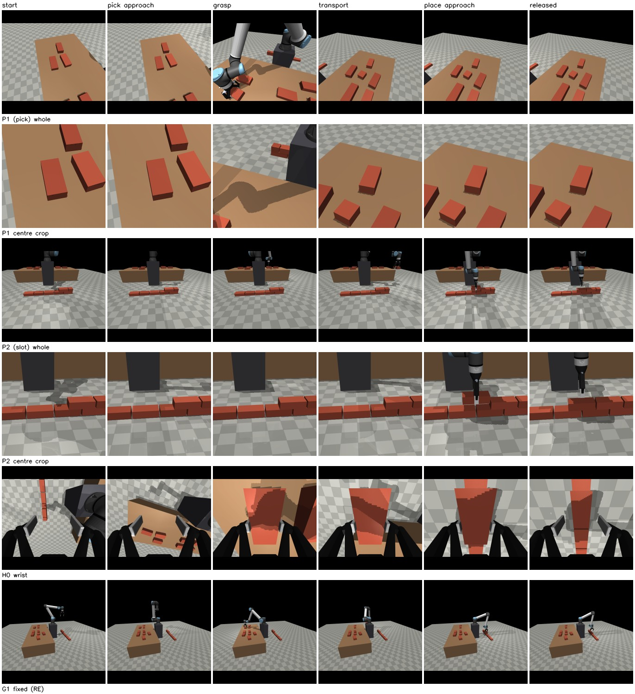

# 보고서 (2차): 움직이는 깊이 카메라로 다시 본 카메라 세팅

> 사용자 지시(11-13): 깊이 카메라를 쓰고, 카메라 자체가 움직이며(바퀴 달린 로봇은 아님), 3대 이하. 회전이 가능할 때를 기준으로 기준을 고쳐 다시 볼 것. 실제 구현 방식과 '의미 있는 곳을 따라가는' 방법을 상위 학술지 · 학회 문헌으로 확인한 다음 구축할 것.
> 문헌: [문헌조사_능동카메라_20261113.md](문헌조사_능동카메라_20261113.md). 고친 기준(결과 전에 커밋 `f95ac6c`): [기준_해석_능동카메라_20261113.md](기준_해석_능동카메라_20261113.md). 1차: [보고서](../근거_카메라선정_20261112/보고서.md).
> 기간: 2026-11-13 21:57 ~ 23:40 (KST). 숫자는 출력 파일에서 읽었다. 표기: **[사실]**, **[판단]**. 선정 배치(820000번대)의 값은 본 실험의 보고 수치로 쓰지 않는다.

## 0. 결론

| 항목 | 결과 |
|---|---|
| 구축 | [사실] 팬 · 틸트 깊이 카메라 모형, 시선 규칙, 기하 계산, 측정, 예시 그림을 `sim/prl/`에 만들었다. 단위 시험 19개 OK, 환경 설정 해시는 1차와 같다 |
| 필수 조건 | [사실] 능동 카메라 세팅 A1 · A2 · A3가 고친 필수 조건 6개를 모두 통과했다 |
| 대조 | [사실] 고정 세팅 RE(G1 + 손목)도 측정을 손목 카메라에 맡기면 통과한다. RD는 놓기 접근 가림 8.0 %로 그대로 미달 |
| 선정 | 아직 없다. 통과 세팅이 넷이라 규칙상 ACT 장당 성공률로 순위를 매겨야 한다. ACT 단계는 하지 않았다(7.2) |
| 회전의 효과 | [사실] 같은 자리에서 돌려도 가림 값은 같았다. 달라진 것은 대상이 영상 가운데에 온다는 점이다. 가운데를 잘라 보면 224 영상에서 벽돌 90 mm가 4 → 11 ~ 25화소가 된다 |
| mm 측정 | [사실] 손목 카메라는 공급대 0.07 mm, 놓인 벽돌 0.10 mm(수평 95백분위). 외부 능동 카메라는 가까운 받침 + 정밀급 인코더일 때만 2 mm 안이고 서보급은 밖이다 |

## 1. 문헌에서 확인한 것 (요약)

| 질문 | 답 | 근거 |
|---|---|---|
| 실제로 카메라를 어떻게 움직이나 | 2축 목(좌우 + 상하)이 가장 흔하다. 다음이 카메라 전용 팔(5 ~ 7축). 깊이 카메라를 팬 · 틸트에 단 선례는 Stretch | Stretch(ICRA 2022), Open-TeleVision(CoRL 2024), AV-ALOHA(ICRA 2025), Vision in Action(CoRL 2025) |
| 의미 있는 곳을 어떻게 따라가나 | 가장 흔한 것은 기하 겨냥: 로봇 좌표계의 3D 점 → 겨냥 역기구학 → 속도 제한. 그다음이 조작자 머리 자세 모방, 검출기로 가운데 맞추기, 강화학습 | PR2 · Fetch point_head, iCub(RSS 2016), OK-Robot(RSS 2024), Eye, Robot(CoRL 2025) |
| 사람의 눈은 어디를 보나 | 접촉이 일어날 곳을 손보다 먼저 본다. 쥘 곳 → 운반이 시작되면 놓을 곳 → 접촉 뒤 다음 대상. 손은 보지 않는다 | Johansson(J. Neurosci. 2001), Land(Perception 1999), Lavoie(J. Vision 2018) |
| 움직이는 깊이 카메라로 mm를 재나 | 그런 논문을 찾지 못했다. 서보 분해능 0.088°는 1.1 m에서 1.7 mm다. mm는 끝단 가까이에서 재거나 외부 추적 계측기로 잰다 | Robotis 안내서, Birbach(ICRA 2012), ETH In situ Fabricator, Hilti(RA-L 2025) |
| 효과가 있나 | 가림 · 탐색에서는 크다. 잘 보이는 정밀 과제에서는 없거나 손해다 | AV-ALOHA 표 I, Vision in Action |

확인하지 못한 것은 문헌조사 7절에 적었다(Johansson의 앞선 시간, 일부 원문, Hadrian X의 심사 논문 등).

## 2. 구축한 것

| 파일 (`sim/prl/`) | 내용 |
|---|---|
| `active_cam.py` | 팬 · 틸트 장치(범위 ± 170° · −80 ~ +30°, 최대 100°/s · 400°/s², 틸트축에서 광학 중심까지 0.03 m), 겨냥 역기구학, 한도 안에서 따라가는 추종기, 시선 규칙, 환경에 붙이는 장치 묶음 |
| `geom_active.py` | 대본 궤적을 재생하며 카메라를 시선 규칙대로 돌리고 가림 · 시선 도달 · 추종 · 화소 크기 · 여유를 잰다 |
| `active_candidates.py`, `select_active.py` | 받침 후보 205곳, 세팅 구성(pick)과 필수 조건 판정(judge) |
| `measure_active.py` | 손목 카메라의 놓인 벽돌 측정, 능동 카메라의 참고 측정(인코더 오차 3등급) |
| `fig_active_20261113.py` | 예시 그림 |
| `sim/tests/test_prl_active.py` | 시험 6개(겨냥 오차, 속도 한도, 시선 전환, 물리에 영향 없음) |

- [사실] 카메라는 모델에 관절을 더하지 않는다(제어 스텝마다 카메라 자세만 바꾼다). 그래서 물리와 환경 설정 해시(`4dcb6e7e…`)가 1차와 같고, 1차의 대본 궤적을 그대로 재생했다.
- [사실] 시선 규칙은 정답 좌표와 대본의 단계 이름을 쓰지 않는다. 도면(공급 칸의 명목 위치, 설계 자리)과 로봇 자기 상태(집게 관절로 본 쥠 · 놓음)만 쓴다.

| 역할 | 보는 곳 |
|---|---|
| 선행 | 집을 벽돌 k → (쥠) → 놓을 자리 k → (놓음) → 다음에 집을 벽돌 |
| 공급 눈 | 집을 벽돌 k → (쥠) → 다음에 집을 벽돌 |
| 벽 눈 | 놓을 자리 k |
| 손 추종 · 고정 | 비교용 |

예시(개발 장면 800230, 7번 자리, 세팅 A3). 위에서부터 공급 눈의 전체 영상과 가운데를 잘라 본 것, 벽 눈의 전체 영상과 잘라 본 것, 손목, 1차의 고정 G1:

A2는 [2차_시선추종_A2.jpg](2차_시선추종_A2.jpg).

## 3. 고친 기준 (1차 → 2차)

| 번호 | 1차 | 2차 |
|---|---|---|
| 1 | 정적 포함 100 % | **시선 도달 100 %**: 관절 범위 안에서 겨냥할 수 있고, 거리가 0.3 ~ 3 m이며, 겨냥했을 때 50 % 이상 보임 |
| 2 · 3 | 집기 · 놓기 접근에서 대상이 모든 영상에서 50 % 미만인 프레임 ≤ 5 % | 그대로. 카메라가 실제로 도는 동안의 영상으로 센다 |
| 4 · 5 | 공급대 · 놓인 벽돌 측정: 수평 95백분위 ≤ 2 mm, 못 잰 비율 ≤ 2 % | 기준값 그대로. **재는 카메라는 손목 H0**(가까이서). 외부 능동 카메라의 값은 참고 |
| 6 | 없음 | **추종**: 접근 구간에서 대상이 맡은 카메라 영상의 가운데 50 % 안에 있는 프레임 ≥ 95 % |

## 4. 받침 후보와 세팅

[사실] 받침 205곳(격자 196 + 1차 위치 9)을 '선행' 역할로 대본 궤적 20벽에서 계산했다(3,316 s). 팔 · 장면과 부딪히지 않는 곳이 189곳, 그중 한 대로 대상 32개에 모두 시선이 닿는 곳은 18곳이다. 규칙대로 뽑힌 세팅(커밋 `76c71c3`, [2차_세팅구성_표.md](2차_세팅구성_표.md)):

| 세팅 | 구성 (손목 H0 포함) | 받침점 (m) | 카메라 수 |
|---|---|---|---|
| A1 | 선행 1대 | M173 (1.60, −0.90, 1.00): 공급대 옆 뒤쪽 | 2 |
| A2 | 선행 + 벽 눈 | M173 + M108 (0.00, 1.60, 0.60): 벽 앞 1 m, 낮게 | 3 |
| A3 | 공급 눈 + 벽 눈 | M089 (0.00, −0.90, 1.00): 공급대 위 0.6 m + M108 | 3 |
| RE (대조) | 고정 G1 | (2.20, −0.50, 1.20) | 2 |
| RD (대조) | 고정 SB1 + WE1 | 1차와 같음 | 3 |

## 5. 결과: 필수 조건

[사실] A1 ~ A3의 1 · 2 · 3 · 6은 실제 역할로 다시 계산한 값이다([2차_기하판정_표.md](2차_기하판정_표.md)). 4는 1차에서 잰 값, 5는 이번에 잰 값이다(820000 ~ 820099, 100벽 × 16, 대본 실패 0, [2차_측정오차_표.md](2차_측정오차_표.md)). 측정 오차는 시뮬레이터 참값과의 차이다: 참값 (진단).

| 세팅 | 1 시선 도달 (공급 · 벽) | 2 집기 접근 가림 | 3 놓기 접근 가림 | 4 공급대 벽돌 (손목) | 5 놓인 벽돌 (손목) | 6 추종 (집기 · 놓기) | 판정 |
|---|---|---|---|---|---|---|---|
| A1 | 16/16 · 16/16 | 0.0 % | 0.9 % | 0.07 mm · 0 % | 0.10 mm · 0 % | 100 % · 100 % | 통과 |
| A2 | 16/16 · 16/16 | 0.0 % | 0.0 % | 0.07 mm · 0 % | 0.10 mm · 0 % | 100 % · 100 % | 통과 |
| A3 | 16/16 · 16/16 | 0.0 % | 0.4 % | 0.07 mm · 0 % | 0.10 mm · 0 % | 100 % · 100 % | 통과 |
| RE (고정) | 16/16 · 16/16 (1차 정의) | 0.0 % | 0.0 % | 0.07 mm · 0 % | 0.10 mm · 0 % | 해당 없음 | 통과 |
| RD (고정) | 16/16 · 16/16 (1차 정의) | 0.0 % | **8.0 %** | 0.07 mm · 0 % | 0.10 mm · 0 % | 해당 없음 | 미달 1개 |

- [사실] 최대 각속도를 30°/s로 낮춰도 맡은 카메라의 추종은 100 % · 100 %였다.
- [사실] RE의 1번은 미리 정한 대로 1차 정의(영상 안에 들어옴)로 봤다. G1 자리를 능동 받침으로 계산하면 깊이 범위 3 m 조건 때문에 15/16 · 13/16이다(먼 대상 4개가 3.03 ~ 3.22 m로 3 m 밖).
- [사실] 1차에서 RE가 떨어진 이유는 G1으로 잰 측정 오차(18.3 · 14.1 mm)였다. 재는 카메라를 손목으로 바꾼 것이 RE의 판정을 바꿨다.

### 참고: 외부 능동 카메라로 잰다면 (필수 조건 아님)

| 대상 | 카메라 | 오차 없음 | 정밀급 (분해능 0.013°) | 서보급 (0.088° + 백래시 0.25°) |
|---|---|---|---|---|
| 공급대 벽돌 | M089 (공급 눈, 위 0.6 m) | 0.50 mm | 0.51 mm | **3.28 mm** |
| 놓인 벽돌 | M108 (벽 눈, 앞 1 m) | 0.97 mm | 0.96 mm | **4.67 mm** |
| 공급대 벽돌 | M173 (선행, 먼 옆) | **21.86 mm** | **21.67 mm** | **23.63 mm** |
| 놓인 벽돌 | M173 (선행, 먼 옆) | **7.83 mm** | **7.92 mm** | **11.86 mm** |

값은 수평 오차 95백분위이고 못 잰 비율은 모두 0 %다. 굵은 글씨는 2 mm 밖이다.

## 6. 회전이 준 것과 주지 못한 것

| 항목 | 값 [사실] |
|---|---|
| 가림 | 같은 받침 M173에서 돌릴 때와 고정할 때가 같다(집기 0.0 %, 놓기 0.9 %) |
| 대상이 영상 가운데 50 % 안 | M173: 선행 100 % · 100 %, 고정 93.1 % · 100 %, 손 추종 63.6 % · 100 % |
| 한 대가 맡는 범위 | 공급 눈 M089는 공급대 위 0.6 m에서 돌면서 16칸에 모두 시선이 닿는다. 산수: 그 높이에서 고정으로 내려다보면 가로 87°로 좌우 ± 0.59 m만 들어와 ± 0.65 · ± 0.91 m 칸은 화각 밖이다 |
| 224 영상에서 벽돌 90 mm (가장 먼 대상, 전체 영상) | RE 3.4 / 3.5화소, A1 4.0 / 3.9, A2 4.0 / 8.6, A3 8.4 / 8.6 (공급 / 벽) |
| 가운데 448 × 448을 잘라 224로 보면 | A1 11.4 / 11.2화소, A2 11.4 / 24.6, A3 24.0 / 24.6 |

- [판단] 회전만으로는 가림이 줄지 않는다(같은 자리에서 본 시선은 그대로다). 1차에서 걸린 '놓기 접근 가림'이 풀린 것은 회전 때문이 아니라 받침 자리를 다시 훑었기 때문이다(벽 앞 낮은 자리, 공급대 옆 뒤쪽).
- [판단] 회전의 이득은 두 가지다. 대상이 늘 가운데 있어 잘라 볼 수 있다는 것(1차에서 ACT 성공률은 영상 속 벽돌 크기 순서와 거의 같았다), 그리고 한 대를 더 가까이 달 수 있다는 것이다.
- [판단] 손 추종보다 '선행'이 대상을 가운데에 더 잘 둔다. 사람의 시선 순서와 같은 결과다.

## 7. 스스로 정한 것, 사용자가 정해야 할 것, 한계

### 7.1 스스로 정한 것 (기준_해석 2차에 결과 전에 고정)

| 항목 | 내용 |
|---|---|
| 지시의 해석 | 외부 카메라 = 고정 받침 위 팬 · 틸트 2축. 위치를 옮기는 카메라(레일, 카메라 팔)는 만들지 않음 |
| 장치 값 | 팬 ± 170°, 틸트 −80 ~ +30°, 100°/s, 400°/s², 광학 중심 0.03 m. 가속도와 0.03 m는 문헌 값이 없어 정함 |
| 시선 | 기하 겨냥, 목표는 도면, 전환은 집게 관절 0.12 rad |
| 측정 담당 | 손목 카메라. 놓인 벽돌은 놓은 직후 후퇴 자세에서 잰다 |
| 추종 조건 | 가운데 50 %, 95 % |
| 받침 후보와 구성 규칙 | 격자 196 + 1차 위치 9, 0.5 %p 이내면 더 가까운 받침 |
| 인코더 오차 등급 | 정밀급 0.013°, 서보급 0.088° + 백래시 0.25° |
| 선정 배치 재사용 | 측정에 820000 ~ 820099를 한 번 더 썼다(쓰임은 여전히 카메라 선정) |

### 7.2 사용자가 정해야 할 것

| 번호 | 정할 것 | 관련 사실 |
|---|---|---|
| 1 | 측정을 손목 카메라에 맡겨도 되는지 | 그렇게 하면 측정 조건은 모든 세팅이 같은 값으로 통과하고, 고정 RE도 통과한다. 외부 카메라가 재야 한다면 정밀급 인코더 + 가까운 받침만 2 mm 안이다 |
| 2 | ACT 선별을 어떻게 할지 | 대상은 RE · A1 · A2 · A3. 카메라가 달라져 시연을 다시 모아야 한다(1차 기준 수집 · 변환 · 검사 약 4.6시간 + 세팅당 학습 · 시험 약 50분). 1차의 3만 스텝은 약했다(5 ~ 22 %) |
| 3 | 정책에 무엇을 넣을지 | 전체 영상, 가운데 잘라 본 영상, 팬 · 틸트 각. 문헌의 표준은 카메라 관절을 관측에 넣는 것이다 |
| 4 | 시선을 규칙으로 둘지 정책이 내게 할지 | 문헌의 표준은 한 정책이 팔과 카메라를 함께 낸다. 지금은 규칙이고 세 방식이 같은 시선을 쓴다 |
| 5 | 위치를 옮기는 카메라까지 볼지 | 회전만으로는 가림이 줄지 않는다. 카메라 전용 팔은 문헌에 많지만 만들지 않았다 |
| 6 | 머리 위 받침을 허용할지 | A3의 공급 눈은 공급대 위 0.6 m다. 현장에서는 구조물이 필요하다 |
| 7 | 1차 보고서 6.2의 나머지 | 압축 영상과 원본 그림의 차이, 장 단위 시험의 시작 자세 |

[판단] 2번을 한다면 RE와 A3를 먼저 비교하는 것이 정보가 가장 많다. 둘은 영상 속 벽돌 크기가 가장 다르고(3.5화소 대 8.5화소, 잘라 보면 24화소) 가림은 둘 다 0 %에 가깝다.

### 7.3 하지 않은 것

| 항목 | 이유 |
|---|---|
| ACT 학습 · 장 단위 시험 | 7.2의 2 ~ 4번이 정해지지 않았다. 수집기 · 시험기에 능동 카메라를 붙이는 일도 그때 한다 |
| 5단계(명목 조건 확인) | 선정 세팅이 아직 없다 |
| 손 추종 · 고정 역할의 세팅 | 비교 값만 냈다 |

### 7.4 한계 [판단]

- 움직임 번짐과 진동은 모형에 없다. 문헌은 번짐 때문에 회전 속도를 제한한다.
- 받침 기둥의 형상과 그것이 만드는 가림 · 충돌은 넣지 않았다.
- 깊이 잡음은 1차 모형 그대로다. 실측 보고(Ahn 2019: 1.1 m에서 약 6.6 mm)는 우리 모형(같은 거리 약 2.9 mm)보다 크다.
- 받침 위치의 보정 오차와 손목 카메라의 자세 오차는 0으로 두었다.
- 정밀급 인코더의 백래시 · 반복정밀도는 문서에서 확인하지 못해 넣지 않았다(낙관적).
- 받침 격자와 구성 규칙은 1차 결과를 아는 상태에서 정했다.

## 8. 실행 기록

| 시각 (11-13) | 일 | 출력 (`sim/outputs/prl/`) | 커밋 |
|---|---|---|---|
| 21:57 ~ 22:20 | 문헌 조사 2건, 핵심 4건 재확인(3건 확인, 1건 접속 거부) | 문헌조사 문서 | – |
| 22:25 | 기준 · 문헌 · 코드 커밋(결과 전) | – | `f95ac6c` |
| 22:26 ~ 23:21 | 받침 205곳 기하 계산 (20벽, 3,316 s) | `a2_grid_20261113` | `f95ac6c` |
| 23:21 | 세팅 구성 | `sim/prl/active_settings_20261113.json` | `76c71c3` |
| 23:22 ~ 23:26 | 실제 역할 계산(136 s), 30°/s 민감도(64 s), 측정 절차의 개발 장면 확인(800230 · 800231) | `a2_final_20261113`, `a2_final_w30_20261113`, `dev_measure_active1_20261113` | `76c71c3` |
| 23:27 ~ 23:32 | 측정 100장면 (345 s, 고친 파일 없음) | `a3_measure_20261113` | `76c71c3` |
| 23:33 | 예시 그림(개발 장면 800230), 단위 시험 19개 OK | 이 폴더의 그림 2장 | 이 보고서의 커밋 |

- 쓴 시작값: 800000 ~ 800019(기하), 800230 · 800231(개발), 820000 ~ 820099(측정). 사기설용, 830000번대, 840000번대는 쓰지 않았다.
- GPU 작업은 하나씩 돌렸다. `sim/venv`에 설치한 것, 외부에 올린 것은 없다. 1차의 코드와 수정 금지 파일은 고치지 않았다.
- 예상과 달랐던 것: 받침 격자 계산을 약 5분으로 봤는데 55분 걸렸다(작업자 20개가 서로 느려짐).
