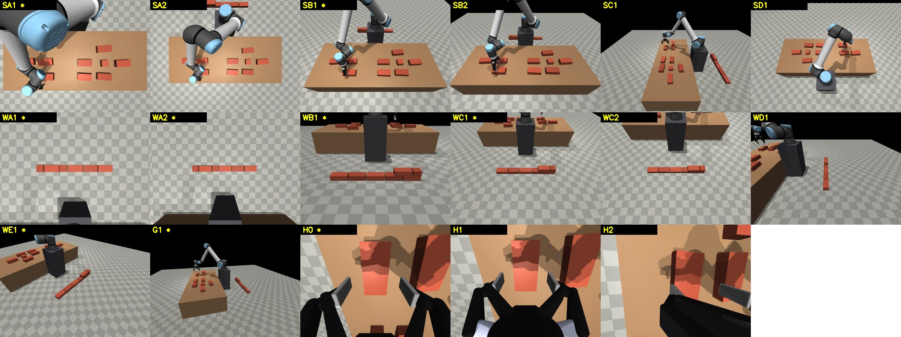
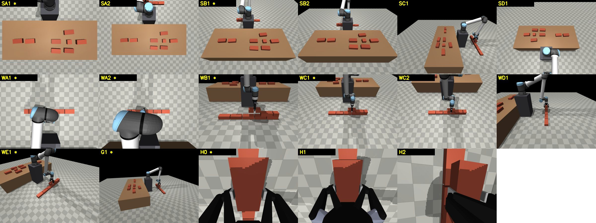

# 보고서: 건식 환경 → 카메라 세팅 선정 (개인 연구, 우분투)

> 지시: [우분투지시_카메라선정_20261112.md](../우분투지시_카메라선정_20261112.md). 기준의 실행 정의(결과를 보기 전에 고정): [기준_해석_20261112.md](기준_해석_20261112.md). 시간순 기록: [진행상황.md](진행상황.md).
> 기간: 2026-11-12 18:44 ~ 2026-11-13 07:04 (KST, `date`). 숫자는 모두 출력 파일에서 읽었다. 표기: **[사실]** 기록에서 확인한 것, **[판단]** 해석.
> 여기 숫자는 카메라 세팅을 고르려고 쓴 배치(820000번대)의 값이다. 본 실험의 보고 수치로 다시 쓰지 않는다.

## 0. 결론

| 항목 | 결과 [사실] |
|---|---|
| 선정 세팅 | **없음.** 필수 조건 5개를 모두 통과한 세팅이 없다. 기준은 낮추지 않았다 |
| 가장 가까운 세팅 | **RD** (SB1 + WE1 + H0). 미달 1개: 놓기 접근 가림 8.0 % (기준 5 % 이하) |
| 5단계 (명목 조건 확인) | 하지 않음. 지시 문서 6.7의 4번(통과 세팅이 없으면 보고하고 멈춤)에 따름 |
| 1단계 (건식 환경) | 대본 50벽 중 50벽 시방 합격 (기준 45벽) → 통과 |
| ACT 3만 스텝의 장당 성공률 | 5.1 ~ 21.5 % (세팅 6개, seed 1000). 가장 높은 것은 지금 세팅 R0 |
| 메모리 | 메모리로 죽은 작업 2, 한도에 닿아 멈춘 작업 1. 컴퓨터가 멈춘 적은 없다 |

## 1. 사양, 한도, 메모리로 죽은 작업

### 1.1 0단계에서 잰 사양 (11-12 18:44) [사실]

| 항목 | 값 |
|---|---|
| RAM | 63,336,148 kB (60.4 GiB), 스왑 8 GiB |
| CPU · GPU | 32 스레드 · RTX 5090, VRAM 32,607 MiB (시작 때 다른 프로그램이 1,467 MiB 사용), 드라이버 595.91.07 |
| 디스크 | `/dev/sda5` 1.8 T, 남은 용량 798 G, 회전식 HDD (스왑도 같은 디스크) |
| 절전 · linger | AC 자동 절전 꺼짐, `Linger=yes` |
| 소프트웨어 | LeRobot 0.6.1, torch 2.11.0+cu128, MuJoCo 3.13.0 (`sim/venv`). 새로 설치한 것 없음 |

### 1.2 한도와 실제 값 [사실]

| 항목 | 정한 한도 | 실제 |
|---|---|---|
| 학습 메모리 | `MemoryMax=36G`, `MemorySwapMax=2G`, `nice 10`, 학습마다 별도 scope | scope 최고 20.1 ~ 36.0 GB (파일 캐시 포함). RE가 36.0 GB로 한도에 닿았지만 죽지 않음 |
| 평가 메모리 | `MemoryMax=30G` | 병렬 8개 × 프로세스당 2.1 GB |
| 수집 · 변환 메모리 | 수집 30G, 변환 묶음당 10G | 고친 뒤 수집 작업자당 최대 3.3 GB, 변환 묶음당 최대 4.2 GB |
| VRAM | 200스텝 시험, 26 GB를 넘으면 배치 반 | 배치 32에서 5.44 GB → 배치 32 유지. 학습 최고 4.66 ~ 5.53 GB, 시험 중 GPU 전체 8,847 ~ 8,858 MiB |
| 평가 병렬 수 P | min(8, RAM 식, VRAM 식) | 8 (프로세스당 RAM 2.1 GB, VRAM 1.0 GB) |
| 데이터 로딩 작업자 | 4 (최대 6) | 4 |
| 학습 나눠 돌리기 | 2만 스텝마다 끝내고 이어 함 | 6번 모두 2만 스텝에서 한 번 끊고 이어 함. 죽어서 다시 시작한 횟수 0 |
| 캐시 예열 | 데이터셋이 RAM의 40 % (24 GB) 이하일 때 | 세팅 데이터셋 6개(4.5 ~ 8.3 GB) 모두 예열함 |
| 디스크 | 남은 용량의 50 % 이내, 50 G 아래면 멈춤 | 남은 용량 798 G → 611 G. 수집 원자료 96.1 GB (300벽 유지) |
| GPU는 한 번에 하나 | 감독 계획에서 단계를 나눔 | 본 학습 · 본 시험은 겹치지 않음. **벗어난 점 1건** (1.4) |
| 감독 | `wall3.supervisor` 방식(systemd 서비스 `prl-supervisor`), 최대 2번 다시 시작 | 감독이 다시 시작한 것: 수집 1번(내가 멈춘 뒤), 변환 묶음 4 · 5 각 1번(메모리로 죽은 뒤). 그 밖은 0. 변환 1차는 내가 멈추고 고친 뒤 다시 띄움 |
| 메모리 감시 | 5분마다 사용 가능 RAM 기록 | 학습 요약(`summary.json`의 `mem_log`)에 기록 |

### 1.3 메모리 사건 [사실]

| 시각 | 작업 | 일 | 원인 | 조치 |
|---|---|---|---|---|
| 11-12 19:44 | 시연 수집 1차 | 한도 30G에 닿아 멈춰 섬 (벽 0개, 죽지는 않음) | 프레임마다 3.7 MB 임시 배열과 0.1 MB 프레임을 번갈아 잡아 힙이 조각남 (작업자당 4.2 ~ 5.9 GB) | 프레임 버퍼를 미리 잡음. 끊긴 출력은 `_STOPPED_1`로 보관 |
| 11-12 22:23, 22:56 | 변환 묶음 5, 묶음 4 | **메모리로 죽음** (한도 10G, systemd 기록 `oom-kill` 2건) | 에피소드마다 영상 인코더 9개를 새로 띄우는데 풀린 메모리가 프로세스에 남음. 벽 경계에서 두 벽이 함께 메모리에 있음. 영상 파일 전체를 매번 다시 써서 HDD 대기 | 앞 벽을 먼저 놓음, 에피소드마다 `malloc_trim`, 인코더 스레드 1, 영상 파일 한도 10 MB → 최대 4.2 GB로 일정 |

- 메모리로 죽은 작업: **2**. 한도에 닿아 멈춘 작업: 1. 컴퓨터 전체가 멈춘 적: 0. 학습 6번 · 장 단위 시험 6번에서 죽은 작업: 0.

### 1.4 한도에서 벗어난 점 [사실]

- 11-12 19:55 ~ 20:43, 시연 수집(GPU로 영상 그리기)이 도는 동안 개발용 짧은 실행을 함께 돌렸다: 측정기 개발 실행(출력 폴더 4개, 1개는 중간에 멈춤), 학습 스모크 200스텝(150 s, 그때 VRAM 최고 12.5 GB), 장 단위 시험 스모크 32시행(465 s). 0단계에서 내가 적은 "GPU는 한 번에 하나"와 어긋난다. 수집은 300벽 모두 깨끗한 합격으로 끝났다.
- RD 학습 · 시험 중에 CPU만 쓰는 작은 진단(정책 추론, 2 ~ 6자리)을 2번 돌렸다. GPU는 쓰지 않았다.

## 2. 건식 환경과 대본 통과 (1단계)

| 항목 | 내용 [사실] |
|---|---|
| 환경 | `dry_v1` (`sim/prl/env.py`의 `DryEnv`). wall3의 환경을 상속했고 wall3 파일은 고치지 않았다. main_v1 장면 값 그대로 + 모르타르 판 없음 + 놓인 벽돌을 고정하지 않음(마찰로만 섬). 설계 높이 28.5 · 85.5 · 142.5 mm |
| 설정 해시 | `4dcb6e7e2d08d99a808b00863d9eb0647777f4e9c4813e67a1ab4f429f7e2aee` (1 ~ 4단계의 모든 출력에서 같음) |
| 대본 | main_v1 대본 그대로. 받침 높이만 아래 단 벽돌의 실제 윗면을 씀. 대본은 정답 좌표를 쓴다: 참값 (진단) |
| 시방 합격 (건식) | 16자리 채움 + ② ③ ④ (6 mm) + ⑤. ①은 값만 남김 |
| 장 단위 시험 | `reset_piece`(앞선 벽돌을 설계 자세에 놓고 0.5 s 가라앉힘)와 `sim/prl/eval_piece.py`. 장당 성공 = 벽돌 k가 자리 k를 채움 + 미리 놓은 벽돌이 모두 제 자리를 채움 |
| **대본 통과 확인** | 800100 ~ 800149, 50벽 중 **50벽 시방 합격** (기준 45벽 이상). 중단 0, 과부하 해제 0 |
| 항목 값 (50벽) | ② 중앙값 0.51 · 최대 0.59 mm, ③ 0.61 · 0.79 mm, ④ 0.45 · 0.47 mm |
| 벽돌 800장의 수평 오차 | 중앙값 0.11 mm, 95백분위 0.19 mm, 최대 0.24 mm |
| 단위 시험 | `sim/tests/test_prl_*.py` 13개 OK (11-13 07:06에 다시 돌림) |

## 3. 카메라 위치 후보의 기하 지표 (2단계)

[사실] 대본 궤적 20벽(800000 ~ 800019, 모두 시방 합격)을 5스텝마다 재생했다(11,501프레임 × 카메라 17개). 정의는 기준_해석 3절이다. 원자료는 `2단계_기하지표.json`이다.

| 카메라 | 위치 (m) | 정적 포함: 공급 / 벽 (포함만) | 집기 접근: 집을 벽돌 중앙값 / 50 % 미만 | 놓기 접근: 놓을 자리 중앙값 / 50 % 미만 | 원본 mm/화소 (공급 / 벽) | 224에서 90 mm (화소) | 입사각 최대 (°) | 깊이 σ (mm) | 팔과의 여유 (m) |
|---|---|---|---|---|---|---|---|---|---|
| SA1 | (0.00, -0.52, 1.45) | 14/16 (14) / 0/16 (0) | 100 % / 10.5 % | 0 % / 100.0 % | 1.55 / 2.07 | 10.2 / 7.6 | 42 / 43 | 2.6 / 4.6 | 0.105 |
| SA2 | (0.00, -0.52, 1.75) | 16/16 (16) / 0/16 (0) | 100 % / 13.9 % | 29 % / 89.2 % | 1.99 / 2.51 | 7.9 / 6.3 | 35 / 37 | 4.3 / 6.8 | 0.352 |
| SB1 | (0.00, -1.25, 1.50) | 16/16 (16) / 8/16 (16) | 100 % / 0.0 % | 36 % / 53.7 % | 2.17 / 3.30 | 7.3 / 4.8 | 51 / 55 | 5.1 / 11.8 | ≥ 0.50 |
| SB2 | (0.00, -1.45, 1.35) | 16/16 (16) / 8/16 (16) | 100 % / 0.0 % | 34 % / 52.3 % | 2.24 / 3.50 | 7.0 / 4.5 | 58 / 61 | 5.4 / 13.2 | ≥ 0.50 |
| SC1 | (1.50, -0.52, 1.50) | 16/16 (16) / 16/16 (16) | 100 % / 0.0 % | 76 % / 6.6 % | 3.83 / 3.55 | 4.1 / 4.4 | 66 / 59 | 15.9 / 13.6 | ≥ 0.50 |
| SD1 | (0.00, 0.20, 1.90) | 12/16 (16) / 0/16 (0) | 86 % / 33.0 % | 0 % / 100.0 % | 2.63 / 2.22 | 6.0 / 7.1 | 35 / 19 | 7.5 / 5.3 | 0.399 |
| WA1 | (0.00, 0.60, 1.85) | 0/16 (0) / 16/16 (16) | 0 % / 100.0 % | 7 % / 99.4 % | 1.25 / 1.55 | 12.6 / 10.2 | 45 / 15 | 2.9 / 4.4 | 0.478 |
| WB1 | (0.00, 1.75, 0.75) | 10/16 (16) / 16/16 (16) | 100 % / 19.8 % | 83 % / 1.1 % | 2.33 / 1.30 | 6.8 / 12.1 | 82 / 65 | 8.9 / 2.8 | ≥ 0.50 |
| WC1 | (0.00, 1.45, 1.10) | 12/16 (13) / 16/16 (16) | 100 % / 13.2 % | 76 % / 9.0 % | 2.92 / 1.99 | 5.4 / 7.9 | 73 / 45 | 9.2 / 4.3 | ≥ 0.50 |
| WC2 | (0.00, 1.20, 1.30) | 0/16 (0) / 16/16 (16) | 8 % / 51.5 % | 72 % / 36.7 % | 2.50 / 2.05 | 6.3 / 7.7 | 66 / 33 | 6.7 / 4.5 | ≥ 0.50 |
| WD1 | (1.35, 0.60, 0.95) | 1/16 (6) / 16/16 (16) | 0 % / 74.0 % | 94 % / 16.9 % | 3.26 / 2.92 | 4.8 / 5.4 | 77 / 66 | 11.5 / 9.2 | 0.487 |
| WE1 | (0.90, 1.40, 1.20) | 11/16 (14) / 16/16 (16) | 98 % / 19.5 % | 72 % / 8.0 % | 3.52 / 2.79 | 4.5 / 5.7 | 73 / 56 | 13.3 / 8.4 | ≥ 0.50 |
| H0 | 손목 | 0/16 (3) / 10/16 (10) | 88 % / 44.5 % | 100 % / 39.0 % | 1.83 / 1.96 | 8.6 / 8.0 | 63 / 31 | 8.5 / 9.8 | 0.052 |
| H1 | 손목 | 0/16 (2) / 9/16 (9) | 23 % / 56.6 % | 92 % / 39.0 % | 1.64 / 1.75 | 9.6 / 9.0 | 61 / 30 | 8.1 / 9.1 | 0.062 |
| H2 | 손목 | 0/16 (4) / 12/16 (12) | 42 % / 50.7 % | 59 % / 39.0 % | 1.63 / 1.52 | 9.6 / 10.4 | 64 / 28 | 8.0 / 6.9 | 0.061 |
| WA2 | (0.00, 0.65, 1.30) | 0/16 (0) / 16/16 (16) | 0 % / 100.0 % | 14 % / 69.9 % | 1.41 / 1.84 | 11.2 / 8.5 | 59 / 21 | 2.1 / 3.7 | 0.080 |
| G1 | (2.20, -0.50, 1.20) | 16/16 (16) / 16/16 (16) | 100 % / 0.0 % | 83 % / 0.0 % | 4.66 / 4.50 | 3.4 / 3.5 | 76 / 70 | 23.5 / 21.8 | ≥ 0.50 |

- [사실] WA2는 팔과의 여유가 0.047 m여서 규칙대로 (0, 0.60, 1.30) → (0, 0.65, 1.30)으로 옮겼다. G1은 격자 27곳 중 가림 합이 가장 작은 (2.2, −0.5, 1.2)이다.
- [사실] 계열별 최선: SA1, SB1, WA2, WC1, WE1, 손목 H0 (규칙은 기준_해석 4절, 근거 값은 진행상황 2단계).
- [사실] 계산 중에 구현 오류 2건을 찾아 고쳤다. 둘 다 세팅을 확정해 커밋하기 전이다. (1) 깊이 · 분할 영상이 다중 표본 때문에 화소 중심에서 어긋나 비스듬한 카메라의 깊이가 1 ~ 6 mm 틀림 → 깊이 · 분할은 다중 표본 없이 그림. (2) 자리에 들어간 벽돌을 가리는 것으로 셈 → 기존 채움 판정 범위 안이면 보이는 것으로 셈. 고치기 전 계산은 `INVALID` 이름으로 남겼고 쓰지 않았다.

예시 영상 (* = 세팅에 쓰는 카메라):

## 4. 세팅 6개: 좌표, 측정 오차, ACT 선별, 선정 규칙

### 4.1 구성과 좌표 [사실]

세팅은 학습 전에 확정해 커밋했다(`sim/prl/settings_20261112.json`, 커밋 `715f001`, 그 뒤 고치지 않음).

| 세팅 | 뜻 | 구성 | 영상 수 |
|---|---|---|---|
| R0 | 지금 세팅 (대조) | WB1 + WA1 + H0 | 3 |
| RA | 영역마다 수직 | SA1 + WA2 + H0 | 3 |
| RB | 맞은편에서 비스듬히 | SB1 + WC1 + H0 | 3 |
| RC | 혼합 | SA1 + WC1 + H0 | 3 |
| RD | 벽을 옆 · 대각에서 | SB1 + WE1 + H0 | 3 |
| RE | 외부 1대 + 손목 | G1 + H0 | 2 |

| 카메라 | 위치 (m) | 보는 점 (m) | 세로 화각 | 쓰는 세팅 |
|---|---|---|---|---|
| WB1 | (0, 1.75, 0.75) | (0, 0.55, 0.10) | 50° | R0 |
| WA1 | (0, 0.60, 1.85) | (0, 0.60, 0) 수직 | 45° | R0 |
| SA1 | (0, −0.52, 1.45) | (0, −0.52, 0) 수직 | 70.9° | RA, RC |
| WA2 | (0, 0.65, 1.30) | (0, 0.60, 0) | 70.9° | RA |
| SB1 | (0, −1.25, 1.50) | (0, −0.50, 0.38) | 70.9° | RB, RD |
| WC1 | (0, 1.45, 1.10) | (0, 0.60, 0.09) | 70.9° | RB, RC |
| WE1 | (0.90, 1.40, 1.20) | (0, 0.60, 0.09) | 70.9° | RD |
| G1 | (2.20, −0.50, 1.20) | (0, 0.04, 0.235) | 70.9° | RE |
| H0 | 손목 (지금 장착 그대로) | – | 80° | 모두 |

원본 영상은 1280 × 960(색 + 깊이)이고, 정책 입력은 비율을 유지해 224 × 168로 줄인 뒤 위아래를 채운 224 × 224다.

### 4.2 측정 오차 (3단계) [사실]

820000 ~ 820099, 100장면 × 16자리. 측정기(`sim/prl/perception.py`)는 개발 장면(800200번대)에서만 만들고 커밋 `3341755`로 고정한 뒤 한 번만 쟀다. 오차는 측정값과 시뮬레이터 참값의 차이다: 참값 (진단). 깊이에는 잡음 모델을 넣었다.

| 세팅 | 공급대 카메라 | 공급대 수평 오차 mm (중앙 / 95백분위 / 최대) | 못 잰 비율 | 벽 카메라 | 놓인 벽돌 수평 오차 mm (중앙 / 95백분위 / 최대) | 못 잰 비율 | 측정 조건 |
|---|---|---|---|---|---|---|---|
| R0 | H0 | 0.02 / 0.07 / 0.13 | 0.00 % | WA1 | 0.37 / 0.57 / 0.77 | 0.00 % | 통과 |
| RA | SA1 | 0.16 / 0.60 / 2.51 | 0.00 % | WA2 | 0.37 / 0.74 / 1.08 | 0.00 % | 통과 |
| RB | SB1 | 0.26 / 0.59 / 1.07 | 0.00 % | WC1 | 0.55 / 1.18 / 1.49 | 0.00 % | 통과 |
| RC | SA1 | 0.16 / 0.60 / 2.51 | 0.00 % | WC1 | 0.55 / 1.18 / 1.49 | 0.00 % | 통과 |
| RD | SB1 | 0.26 / 0.59 / 1.07 | 0.00 % | WE1 | 0.52 / 1.72 / 4.59 | 0.00 % | 통과 |
| RE | G1 | 1.31 / 18.26 / 38.24 | 6.25 % | G1 | 3.49 / 14.06 / 34.34 | 6.25 % | 미달 |

- G1이 못 잰 것은 항상 같은 자리다 (공급대 0번 자리 100/100, 놓인 벽돌 5번 자리 100/100).
- 든 벽돌을 포함한 대상 · 카메라별 표는 [3단계_측정오차_표.md](3단계_측정오차_표.md)에 있다 (든 벽돌은 필수 조건에 넣지 않음).

### 4.3 ACT 선별 (4단계) [사실]

| 항목 | 값 |
|---|---|
| 시연 | 810000 ~ 810299, 300벽 모두 깨끗한 합격. 4,800에피소드, 849,997프레임, 카메라 9대를 한 번에 기록 |
| 데이터셋 검사 | 숫자 열은 원자료와 전부 일치, 영상 전수 디코딩 통과, 30벽의 영상 차이 카메라별 최대 1.8 ~ 3.9 (255 기준), 문제 0건 |
| 학습 | 세팅마다 ACT 1개, seed 1000, 3만 스텝, 배치 32, 정책 설정은 본 학습과 같은 기본값 (행동 묶음 100) |
| 시험 | 장 단위, 16자리 × 50장면 (820000 ~ 820049) = 800시행, 정책 단독 |

학습:

| 세팅 | 구성 | 학습 시간 (s) | 죽은 횟수 | l1 손실: 5천 / 1만 / 2만 / 3만 | VRAM 최고 (GB) | 메모리 최고 (GB, 한도 36) | 학습 끝 |
|---|---|---|---|---|---|---|---|
| R0 | WB1 + WA1 + H0 | 2,188 | 0 | 0.105 / 0.074 / 0.055 / 0.045 | 5.45 | 24.0 | 11-13 06:52 |
| RA | SA1 + WA2 + H0 | 2,217 | 0 | 0.107 / 0.075 / 0.054 / 0.043 | 5.52 | 34.0 | 11-13 06:04 |
| RB | SB1 + WC1 + H0 | 2,356 | 0 | 0.107 / 0.076 / 0.055 / 0.044 | 5.53 | 24.9 | 11-13 02:50 |
| RC | SA1 + WC1 + H0 | 2,219 | 0 | 0.106 / 0.075 / 0.054 / 0.044 | 5.53 | 20.1 | 11-13 04:34 |
| RD | SB1 + WE1 + H0 | 2,275 | 0 | 0.107 / 0.075 / 0.055 / 0.044 | 5.53 | 26.1 | 11-13 03:41 |
| RE | G1 + H0 | 2,077 | 0 | 0.105 / 0.075 / 0.054 / 0.044 | 4.66 | 36.0 | 11-13 05:18 |

장 단위 시험 (구간은 장면 단위 부트스트랩 10,000번):

| 세팅 | 장당 성공 | 95 % 구간 | 들어 올린 비율 | 시간 초과 | 못 듦 | 들었지만 자리 밖 | 그 밖의 실패 | 채운 것의 수평 오차 중앙값 | 6 mm 이내 (전체 시행 중) | 병렬 수 | 시험 시간 (s) | 시험 끝 |
|---|---|---|---|---|---|---|---|---|---|---|---|---|
| R0 | 172/800 = 21.5 % | 19.8 ~ 23.2 % | 53.5 % | 8.0 % | 372 | 256 | 0 | 16.8 mm (n = 172) | 1.62 % | 8 | 557 | 11-13 07:02 |
| RA | 125/800 = 15.6 % | 13.9 ~ 17.6 % | 26.2 % | 42.5 % | 590 | 85 | 0 | 18.0 mm (n = 125) | 0.12 % | 8 | 692 | 11-13 06:15 |
| RB | 69/800 = 8.6 % | 7.4 ~ 9.9 % | 26.0 % | 26.2 % | 592 | 139 | 0 | 19.5 mm (n = 69) | 0.12 % | 8 | 691 | 11-13 03:03 |
| RC | 65/800 = 8.1 % | 6.8 ~ 9.5 % | 35.5 % | 8.5 % | 516 | 219 | 0 | 16.1 mm (n = 65) | 0.00 % | 8 | 555 | 11-13 04:43 |
| RD | 41/800 = 5.1 % | 3.9 ~ 6.4 % | 29.0 % | 49.6 % | 568 | 191 | 0 | 14.5 mm (n = 41) | 0.25 % | 8 | 783 | 11-13 03:56 |
| RE | 45/800 = 5.6 % | 4.5 ~ 6.9 % | 22.9 % | 15.9 % | 617 | 138 | 0 | 17.6 mm (n = 45) | 0.00 % | 8 | 454 | 11-13 05:26 |

자리별 성공률 (%, 자리마다 50시행):

| 세팅 | 0 | 1 | 2 | 3 | 4 | 5 | 6 | 7 | 8 | 9 | 10 | 11 | 12 | 13 | 14 | 15 |
|---|---|---|---|---|---|---|---|---|---|---|---|---|---|---|---|---|
| R0 | 0 | 0 | 0 | 100 | 90 | 0 | 0 | 0 | 2 | 66 | 0 | 0 | 0 | 0 | 44 | 42 |
| RA | 0 | 0 | 6 | 80 | 8 | 0 | 0 | 0 | 4 | 86 | 16 | 0 | 4 | 2 | 6 | 38 |
| RB | 0 | 0 | 0 | 76 | 0 | 0 | 0 | 0 | 0 | 0 | 0 | 0 | 0 | 0 | 6 | 56 |
| RC | 0 | 0 | 0 | 72 | 0 | 0 | 0 | 0 | 2 | 20 | 0 | 0 | 0 | 0 | 0 | 36 |
| RD | 0 | 0 | 0 | 32 | 0 | 0 | 0 | 0 | 0 | 2 | 0 | 12 | 2 | 0 | 0 | 34 |
| RE | 4 | 0 | 0 | 0 | 0 | 0 | 0 | 2 | 0 | 0 | 0 | 0 | 0 | 0 | 24 | 60 |

### 4.4 선정 규칙을 적용한 과정 [사실]

계산은 `sim/prl/select_final.py`(결과 전에 커밋 `72ca488`), 출력은 [4단계_선정규칙_표.md](4단계_선정규칙_표.md) · `4단계_선정규칙.json`이다. 굵은 글씨가 미달 항목이다.

| 세팅 | 구성 | 정적 포함 | 집기 접근 가림 | 놓기 접근 가림 | 공급대 벽돌 측정 (수평 95백분위 · 못 잼) | 놓인 벽돌 측정 | 필수 조건 | ACT 장당 성공률 (95 % 구간) | 채운 것의 수평 오차 중앙값 | 6 mm 이내 |
|---|---|---|---|---|---|---|---|---|---|---|
| R0 | WB1 + WA1 + H0 | **10/16 · 16/16** | **10.1 %** | 1.1 % | 0.07 mm · 0.0 % | 0.57 mm · 0.0 % | 미달 2개 | 21.5 % (19.8 ~ 23.2) | 16.8 mm | 1.6 % |
| RA | SA1 + WA2 + H0 | **14/16 · 16/16** | 0.0 % | **39.0 %** | 0.60 mm · 0.0 % | 0.74 mm · 0.0 % | 미달 2개 | 15.6 % (13.9 ~ 17.6) | 18.0 mm | 0.1 % |
| RB | SB1 + WC1 + H0 | 16/16 · 16/16 | 0.0 % | **8.8 %** | 0.59 mm · 0.0 % | 1.18 mm · 0.0 % | 미달 1개 | 8.6 % (7.4 ~ 9.9) | 19.5 mm | 0.1 % |
| RC | SA1 + WC1 + H0 | 16/16 · 16/16 | 0.0 % | **9.0 %** | 0.60 mm · 0.0 % | 1.18 mm · 0.0 % | 미달 1개 | 8.1 % (6.8 ~ 9.5) | 16.1 mm | 0.0 % |
| RD | SB1 + WE1 + H0 | 16/16 · 16/16 | 0.0 % | **8.0 %** | 0.59 mm · 0.0 % | 1.72 mm · 0.0 % | 미달 1개 | 5.1 % (3.9 ~ 6.4) | 14.5 mm | 0.2 % |
| RE | G1 + H0 | 16/16 · 16/16 | 0.0 % | 0.0 % | **18.26 mm · 6.2 %** | **14.06 mm · 6.2 %** | 미달 2개 | 5.6 % (4.5 ~ 6.9) | 17.6 mm | 0.0 % |

(RE의 못 잰 비율은 6.25 %다. 이 표는 소수 첫째 자리로 적혀 6.2 %로 보인다.)

| 순서 | 규칙 (지시 문서 6.7) | 적용 결과 |
|---|---|---|
| 1 | 필수 조건 | 통과 0개. R0: 정적 포함(공급 10/16), 집기 접근 가림 10.1 %. RA: 정적 포함(공급 14/16), 놓기 접근 가림 39.0 %. RB · RC · RD: 놓기 접근 가림 8.8 · 9.0 · 8.0 %. RE: 측정 2항목 |
| 2 | 순위 (통과한 세팅을 ACT 성공률로) | 통과한 세팅이 없어 순위를 매기지 않음. 성공률은 참고 값 |
| 3 | 동률 | 해당 없음 |
| 4 | 통과 세팅이 없으면 가장 가까운 세팅과 미달 항목을 보고하고 멈춤 | 미달 1개인 RB · RC · RD 가운데 (값 ÷ 기준 − 1)이 가장 작은 **RD** (0.59. RB 0.76, RC 0.81). 미달 2개: R0 1.40, RA 6.93, RE 18.41 |
| 5 | R0가 가장 좋아도 그대로 보고 | R0의 ACT 성공률이 21.5 %로 가장 높다. R0는 필수 조건 2개 미달(예상대로 공급대를 보는 고정 카메라가 없음) |
| – | 1 · 2위의 seed 2000 · 3000 추가 학습 | 통과 세팅이 없어 하지 않음 (기준_해석 8절) |

### 4.5 읽을 때 주의할 점

- [사실] 세팅 6개 모두 장당 성공률이 낮다(5.1 ~ 21.5 %). 채운 벽돌의 수평 오차 중앙값은 14.5 ~ 19.5 mm이고(허용 6 mm), 6 mm 이내로 놓은 것은 전체 시행의 0 ~ 1.6 %다. 성공이 한 번이라도 나온 자리는 세팅마다 3 ~ 10개다. 3만 스텝의 l1 손실은 0.043 ~ 0.045로 세팅 사이에 차이가 없다.
- [사실] 성공률 순서는 224 영상에서 벽 쪽 고정 카메라가 보는 벽돌의 크기 순서와 거의 같다. RD와 RE만 순서가 바뀌었고 두 구간은 겹친다.

| 세팅 | 벽 쪽 고정 카메라: 224 영상에서 90 mm (화소) | 장당 성공률 |
|---|---|---|
| R0 | WA1 10.2, WB1 12.1 | 21.5 % |
| RA | WA2 8.5 | 15.6 % |
| RB | WC1 7.9 | 8.6 % |
| RC | WC1 7.9 | 8.1 % |
| RE | G1 3.5 | 5.6 % |
| RD | WE1 5.7 | 5.1 % |

- [판단] 3만 스텝 ACT에서는 가림보다 영상 속 벽돌 크기가 성공률과 함께 움직였을 수 있다. seed가 1개이고 성공률이 낮아 확인된 것은 아니다.
- [사실] 진단(결과 아님, 학습 장면 810000, RB 정책): 목표 정보 · 장면 · 관절 상태는 학습 데이터와 맞는다. 정책은 학습이 본 관측 그대로에서도 시연과 관절각이 평균 0.02 ~ 0.05 rad 다르다. 같은 장면의 압축 영상(학습)과 원본 그림(시험) 사이에서는 행동이 평균 0.02 ~ 0.08 rad 달라진다. 숫자: `4단계_진단_관측일치_RB.json`, `4단계_진단_민감도_RB.md`.
- [판단] 낮은 성공률은 시험 쪽 구성 오류보다 3만 스텝 정책의 정밀도 부족으로 보인다. [사실] 사기설 본 학습(ACT, 같은 정책 설정)의 l1은 3만 스텝 0.042, 10만 스텝 0.025였다.
- [판단] 한계(지시 문서 6.7): 선별에 ACT만 썼으므로 선정이 ACT 쪽으로 기울 수 있다. 영상 3장 · 224 · 외부 + 손목 구성으로 VLA의 입력 관행을 맞춘 것이 그 대응이다.

## 5. 명목 조건 확인 (5단계)

하지 않았다. 선정 세팅이 없기 때문이다. 830000번대와 840000번대 시작값은 쓰지 않았다.

## 6. 스스로 정한 것, 사용자가 정해야 할 것, 포기한 것

### 6.1 스스로 정한 것

결과를 보기 전에 파일로 고정한 것 (기준_해석 1 ~ 7절은 11-12 18:57 커밋 `1e2b01a`, 8절은 20:50 커밋 `72ca488`):

| 항목 | 정한 내용 (자세한 것은 기준_해석의 해당 절) |
|---|---|
| 장당 성공 · 시행의 끝 · 실패 종류 | 1절. 성공 = 벽돌 k 채움 + 미리 놓은 벽돌 유지 |
| 화각 · 카메라 방향 | 2절. 가로 87° → 세로 70.9°, 수직 카메라는 영상 위쪽 = +y |
| 손목 H1 · H2 장착 위치 | 2절 |
| 카메라 몸체와 여유 | 2절. 반지름 0.05 m 구, 여유 0.05 m, 겹치면 0.05 m씩 바깥으로 |
| 깊이 잡음 모델 | 2절. D435급 · D405급, 시차 잡음 0.08화소, 7화소 상자 평균으로 상관 |
| 기하 지표의 정의 | 3절. 구간, 보이는 비율, 정적 포함(영상 가운데 90 % 안 + 50 % 이상 보임) |
| 계열별 '최선'과 G1 | 4절. 동률은 0.5 %p 이내, G1은 격자 27곳 |
| 필수 조건의 계산 | 5절. 집기 접근과 놓기 접근을 따로 봄(더 엄격한 쪽) |
| 측정 절차 | 6절. 대상별 재는 시점 · 카메라, 못 잰 것의 정의 |
| 학습 · 시험 설정 | 7절 |
| 필수 항목 5개, '가장 가까운 세팅', 통과 세팅이 없을 때의 처리 | 8절 |
| 측정기의 높이 보정값 | 8절. 개발 장면과 기하용 궤적에서 재서 상수로 씀 |

실행하면서 정한 것:

| 항목 | 정한 내용 |
|---|---|
| 개발용 시작값 | 800200 ~ 800299 (측정기 개발 800200 ~ 800209, 스모크 800210 · 800211 · 800220 · 800221). 보고 수치에 쓰지 않음 |
| 기록한 카메라 | 세팅에 들어가는 9대 (G1, H0, SA1, SB1, WA1, WA2, WB1, WC1, WE1) |
| 학습 순서 | RB → RD → RC → RE → RA → R0 |
| 변환 옵션 | 인코더 스레드 1, 영상 파일 한도 10 MB, 에피소드마다 메모리 반환. 합친 뒤 영상 비교 벽 30개 |
| 진단 단계 | RB 결과가 낮아 관측 일치 진단을 RD 학습과 RD 시험 사이에 넣음. 학습 장면만 썼고 본 계산의 순서 · 설정은 그대로 |
| 6단계 | 하지 않음. 통과 세팅이 없으면 멈추라는 규칙을 따름 |
| 남은 파일 | 지우지 않음 (6.2의 7번) |
| 인계 파일 | `CLAUDE.md`에 "이 지시 문서는 한 번 실행을 마쳤다, 다시 실행하기 전에 사용자에게 확인한다"는 줄을 더함 (같은 12시간 실행을 되풀이하지 않게). 사용자가 지워도 됨 |

### 6.2 사용자가 정해야 할 것

| 번호 | 정할 것 | 관련 사실 |
|---|---|---|
| 1 | 필수 조건을 모두 통과하는 세팅이 없는데 무엇을 바꿀지 | 외부 2대 + 손목 1대, 후보 17곳 안에서는 '가림 5 % 이하'와 '측정 2 mm 이하'가 함께 서지 않았다. RB · RC · RD는 놓기 접근 가림만 3 ~ 4 %p 넘는다. RE는 가림 0 %지만 측정이 14 ~ 18 mm다 |
| 2 | ACT 선별을 3만 스텝 그대로 쓸지 | 성공률 5 ~ 22 %, 수평 오차 중앙값 14.5 ~ 19.5 mm, seed 1개 (4.5) |
| 3 | 선정 기준에 영상 속 벽돌 크기를 넣을지 | 성공률 순서가 벽 쪽 카메라의 화소 크기 순서와 같다 (4.5) |
| 4 | 학습 영상(압축)과 시험 영상(원본)의 차이를 어떻게 할지 | 이 차이만으로 행동이 평균 0.02 ~ 0.08 rad 달라진다. 선택지: 더 긴 학습, 영상 증강, 압축 품질, 시험 영상도 같은 압축을 거치게 하기 |
| 5 | 장 단위 시험의 시작 자세를 고칠지 | 시험 시작 때 팔꿈치가 시연보다 +0.0078 rad다 (6.4). 행동 변화는 0.003 rad 이하 |
| 6 | 6단계(변동 축 구현 스모크, VLA 환경 시험)를 지금 할지 | 하지 않았다 |
| 7 | 남은 파일을 지울지 | 수집 원자료 96.1 GB, 변환 묶음 6개(합쳐서 약 22 GB), `_STOPPED_` · `dev_` · `prl_dbg_` 폴더. 남은 용량 611 G |
| 8 | `prl-supervisor` 서비스를 내릴지 | 계획이 '모두 끝' 상태로 떠 있고 절전 방지를 잡고 있다. 내리려면 `systemctl --user disable --now prl-supervisor` |

[판단] 1번은 기준을 그대로 두고 후보 위치를 더 넣어 2단계(학습 없음, 약 20분)를 다시 하는 것이 가장 싸다. 다만 후보를 결과를 본 뒤에 더하는 것이므로 사용자가 정해야 한다. 나는 후보도 기준도 바꾸지 않았다.

### 6.3 포기한 것 · 하지 않은 것

| 항목 | 이유 |
|---|---|
| 5단계 (명목 조건 확인) | 선정 세팅 없음 |
| seed 2000 · 3000 추가 학습 | 필수 조건을 통과한 1 · 2위에만 하는 것인데 통과 세팅이 없음 |
| 6단계 | 선택 단계이고, 멈춤 규칙을 따름 |
| 후보 위치 추가 · 기준 조정 | 결과를 본 뒤에 바꾸지 않는다는 규칙 |
| GPU 없이 영상 그리기 | OSMesa가 없어 못 함. 그래서 영상이 필요한 진단은 감독 계획의 단계로 넣음 |

### 6.4 알고도 고치지 않은 결함 [사실]

| 결함 | 영향 | 고치지 않은 이유 |
|---|---|---|
| `reset_piece`가 철수 자세를 '명령'으로 잡아 시험 시작 때 팔꿈치가 시연보다 +0.0078 rad | 정책 행동 변화 0.003 rad 이하 | 세팅 6개를 같은 절차로 재려고. 5단계 전에 고칠 항목 |
| `train_act`의 `summary.json`에서 `loss_last`가 0.0으로 적힘 (다른 항을 읽음) | 표의 l1은 `train.log`에서 읽음 | 세팅 6개를 같은 코드로 돌리려고 |
| 장 단위 시험 요약의 `git_commit`이 끝난 시점의 HEAD (`cb0c79b`, `a5b5831`, `2a4eae4`, `c618e89`) | 시험 코드는 `3341755`, 학습 코드는 `cf64fbb` 뒤로 바뀌지 않았다 (`git log`로 확인) | 기록만 다름 |
| 학습은 압축 영상, 시험은 원본 그림 | 6.2의 4번 | 사용자가 정할 일 |
| wall3의 검측(`wall3/perception.py`)도 같은 다중 표본 화소 치우침(최대 0.375화소, 약 0.6 mm)이 있을 수 있음 [판단] | 사기설 쪽 | wall3는 수정 금지. 확인하지 않았다 |

## 7. 실행 명령, 설정 해시, 시각, 커밋

실행은 모두 `cd sim`, `MUJOCO_GL=egl PYTHONPATH=.`에서 했다. 3 · 4단계는 `systemctl --user start prl-supervisor`(계획 `sim/prl/plan_s4_20261112.py`)로 돌렸고, 작업마다 실행 줄은 `sim/outputs/prl/supervisor_s4_20261112/log.txt`에 있다.

| 단계 | 실행 | 출력 (`sim/outputs/prl/` 아래) | 시작 ~ 끝 | 코드 커밋 |
|---|---|---|---|---|
| 0 | 사양 점검, 한도 시험 | 진행상황 0단계 | 11-12 18:44 ~ 18:57 | `1e2b01a` |
| 1 | `python -m prl.run_script --zone script --seed0 800100 --n 50 --workers 10` | `s1_script_20261112` | 18:58 ~ 19:00 | `1e2b01a` |
| 2 궤적 | `python -m prl.run_script --zone geom --seed0 800000 --n 20 --save-traj` | `s2_traj_20261112` | 19:00 ~ 19:01 | `1e2b01a` |
| 2 지표 | `python -m prl.geom_metrics`, `python -m prl.select_settings` | `s2_metrics_c_20261112`, `s2_g1grid_c_20261112`, `s2_clearance_final_20261112`, `s2_static_20261112` | 19:01 ~ 19:22 | `715f001` (계산 뒤 커밋) |
| 3 | `python -m prl.measure --zone select --seed0 820000 --n 100 --workers 8` | `s3_measure_20261112` | 21:41 ~ 23:01 (4,719 s) | 측정기 `3341755`, 실행 때 `72ca488` |
| 4 수집 | `python -m prl.collect --seed0 810000 --n 330 --target-pass 300 --workers 6` | `s4_collect_20261112` | 19:49 ~ 21:41 (1차 19:28 ~ 19:44 중단) | `98bdf2b` |
| 4 변환 | `python -m prl.to_lerobot --raw … --part i 6 --threads 1 --video-mb 10`, 이어서 `--merge`, `--subset` | `sim/data/prl_s4_master_20261112`, `sim/data/prl_s4_{세팅}_20261112` | 23:25 ~ 01:05 (1차 21:41 ~ 23:07 중단), 합치기 ~ 01:25, 세팅별 ~ 02:08 | `5d5aac7` (변환 시작 2분 뒤 커밋) |
| 4 VRAM 시험 | `python -m prl.train_act --probe 200` | `s4_probe_20261112` | 02:08 ~ 02:11 | `cf64fbb` |
| 4 학습 | `python -m prl.train_act --dataset data/prl_s4_{세팅}_20261112 --seed 1000 --steps 30000 --chunk 20000 --batch 32 --workers 4 --mem-gb 36` | `s4_train_{세팅}_s1000_20261112` | 11-13 02:11 ~ 06:52 (4.3의 표) | `cf64fbb` |
| 4 시험 | `python -m prl.eval_piece --ckpt …/pretrained_model --zone select --seed0 820000 --n 50` | `s4_eval_{세팅}_s1000_20261112` | 02:51 ~ 07:03 (4.3의 표) | `3341755` |
| 진단 | `python -m prl.diag_obs --ckpt (RB) --dataset data/prl_s4_RB_20261112` | `s4_diag_obs_RB_20261112` | 03:42 ~ 03:43 | `6e349ff` |
| 선정 | `python -m prl.select_final --measure outputs/prl/s3_measure_20261112 --evals 'outputs/prl/s4_eval_{S}_s1000_20261112'` | 이 폴더의 `4단계_선정규칙.*` | 07:04 | `72ca488` |

| 해시 · 값 | 내용 |
|---|---|
| 환경 설정 해시 | `4dcb6e7e2d08d99a808b00863d9eb0647777f4e9c4813e67a1ab4f429f7e2aee` |
| 합친 데이터셋 해시 | `0947aa47cda6608865aa7f5e075010719bc08c178f3fb33a53e62b129ce77e59` (22.27 GB, 영상 파일 2,178개) |
| 시연 카메라 설정 해시 | `8864f7bcd4e86475…` (`collect_config.json`의 `cams_sha256`) |
| 쓴 시작값 | 800000 ~ 800019 기하, 800100 ~ 800149 대본 확인, 800200번대 개발, 810000 ~ 810299 시연, 820000 ~ 820099 측정(시험은 820000 ~ 820049) |
| 쓰지 않은 시작값 | 700000 ~ 739999 (사기설), 830000번대, 840000번대 |

커밋 (모두 `main`에 올림, 오래된 것부터): `1e2b01a` 0단계 · 기준_해석 · 환경 → `715f001` 1 · 2단계와 세팅 확정 → `bc32cc7`, `98bdf2b` 수집기 → `3341755` 측정기 고정 → `cf64fbb` 계획 → `05d9ea0` → `72ca488` 기준_해석 8절 · 선정 계산 → `5d5aac7` 3단계 결과 · 변환 수정 → `685aa80` 아이디어 문서 → `8d7b185`, `cb0c79b` 데이터셋 · 학습 시작 → `6e349ff`, `93cbbb5`, `a5b5831` RB와 진단 → `2a4eae4` RD · RC → `c618e89` RE · RA → 이 보고서를 담은 커밋.

수정 금지 파일(사기설 문서, `sim/brick_sim/*`, `sim/collect.py`, `sim/eval_policy.py`, `sim/tools/*`)과 `sim/wall3/`는 고치지 않았다. `sim/venv`에 설치한 것도, 외부에 올린 것도 없다.
